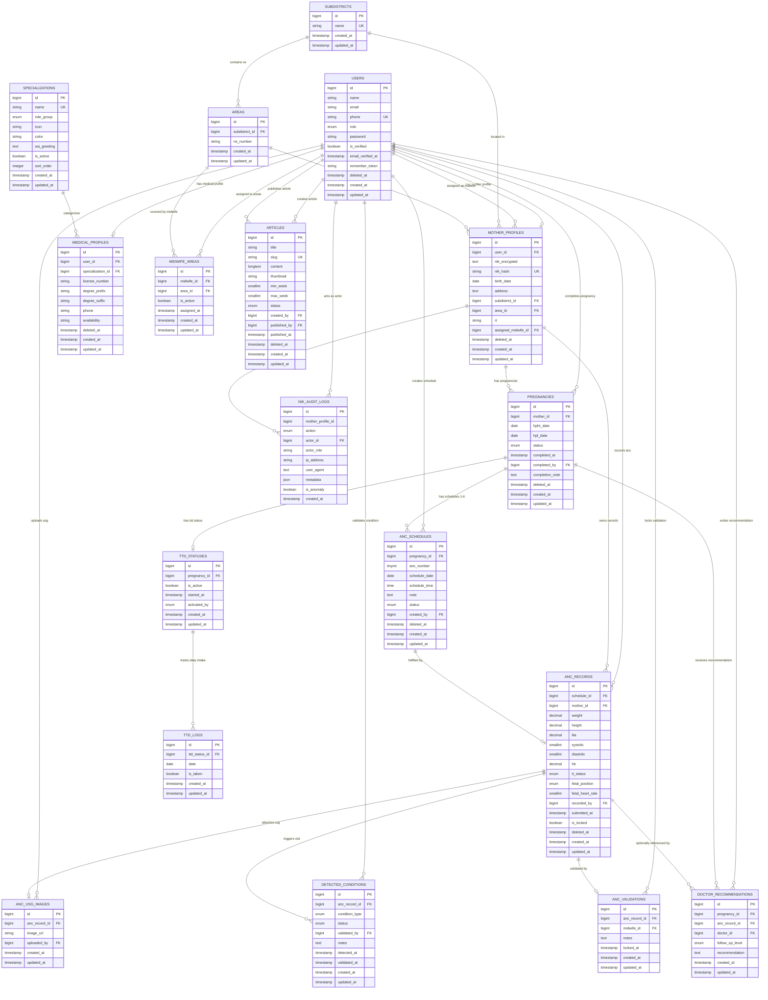

# Entity Relationship Document (ERD) — BumilSehat

---

## 1. Database Overview

| Atribut | Nilai |
| --- | --- |
| **Primary DBMS (Dev & Prod)** | PostgreSQL (sesuai [ADR-0001](./adr/0001-database-selection.md)) |
| **Testing DBMS** | SQLite In-Memory (`:memory:` via `phpunit.xml`) |
| **ORM & Migration Tool** | Laravel 12 Eloquent ORM & Schema Builder |
| **Total Migrasi** | 21 file migrasi di `database/migrations/` |
| **Total Tabel Domain** | 18 tabel bisnis utama |
| **Total Tabel Sistem Laravel** | 7 tabel infrastruktur (`password_reset_tokens`, `sessions`, `cache`, `cache_locks`, `jobs`, `job_batches`, `failed_jobs`) |
| **Sinkronisasi** | 100% diverifikasi terhadap migrasi aktual di `database/migrations/` |

---

## 2. Database Design Principles

1. **Normalisasi 3NF**: Tidak ada kolom multi-value, *partial dependency*, maupun *transitive dependency*. Wilayah dikelola satu *source of truth* (`subdistricts` → `areas`), dan jenis tenaga medis dipisahkan ke tabel master `specializations` agar extensible tanpa migrasi skema.
2. **Soft Deletes pada Data Klinis & Identitas**: Tabel utama (`users`, `mother_profiles`, `medical_profiles`, `pregnancies`, `anc_schedules`, `anc_records`, `articles`) menggunakan `deleted_at` agar riwayat medis tetap dapat ditelusuri dengan `withTrashed()`.
3. **Dual-Storage PII untuk NIK (UU PDP)**: `mother_profiles` menyimpan `nik_encrypted` (ciphertext AES-256-CBC) dan `nik_hash` (HMAC-SHA256 64-hex, `UNIQUE`) tanpa pernah menyimpan NIK plaintext.
4. **Append-Only Audit Trail**: `nik_audit_logs` hanya memiliki `created_at` (tanpa `updated_at`/`deleted_at`) dan diproteksi agar tidak bisa diubah, dihapus, maupun di-drop di production.
5. **Immutability Data Tervalidasi**: `anc_records.is_locked` bersama catatan `anc_validations` menjamin hasil pemeriksaan yang disahkan Bidan bersifat permanen.
6. **Referential Integrity Ketat**: Foreign key menggunakan strategi eksplisit (`cascadeOnDelete`, `restrictOnDelete`, atau `nullOnDelete`) sesuai tingkat kekritisan data medis.

---

## 3. Entity Relationship Diagram

---

## 4. Table Specifications

| # | Nama Tabel | Kategori | Soft Deletes | Model Eloquent | Tujuan Utama |
| :-: | --- | --- | :-: | --- | --- |
| 1 | `users` | Auth & Identity | ✅ | `App\Models\User` | Akun seluruh peran (`mother`, `midwife`, `doctor`, `admin`) |
| 2 | `subdistricts` | Master Wilayah | ❌ | `App\Models\Subdistrict` | Master kelurahan/desa cakupan Puskesmas |
| 3 | `areas` | Master Wilayah | ❌ | `App\Models\Area` | Master RW di dalam setiap kelurahan |
| 4 | `mother_profiles` | Profil Pasien | ✅ | `App\Models\MotherProfile` | Biodata ibu hamil, NIK terenkripsi/hash, domisili, dan Bidan pendamping |
| 5 | `specializations` | Master Medis | ❌ | `App\Models\Specialization` | Master jenis tenaga medis & grup otorisasinya (`midwife`/`doctor`) |
| 6 | `medical_profiles` | Profil Nakes | ✅ | `App\Models\MedicalProfile` | STR/SIP, gelar, nomor konsultasi, dan jadwal ketersediaan nakes |
| 7 | `midwife_areas` | Mapping Wilayah | ❌ | `App\Models\MidwifeArea` | Penugasan Bidan ke area RW binaan |
| 8 | `pregnancies` | Klinis Kehamilan | ✅ | `App\Models\Pregnancy` | Siklus kehamilan (HPHT, HPL, status aktif/selesai, & metadata penutupan) |
| 9 | `anc_schedules` | Klinis ANC | ✅ | `App\Models\AncSchedule` | Jadwal pertemuan ANC ke-1 s.d. ke-6 |
| 10 | `anc_records` | Klinis ANC | ✅ | `App\Models\AncRecord` | Data antropometri, vital sign, lab, janin, dan flag penguncian |
| 11 | `anc_usg_images` | Klinis ANC | ❌ | `App\Models\AncUsgImage` | Bukti foto USG terkait catatan ANC (1:1) |
| 12 | `detected_conditions` | Klinis Risiko | ❌ | `App\Models\DetectedCondition` | Kondisi risiko terdeteksi sistem & keputusan validasi Bidan |
| 13 | `anc_validations` | Klinis Validasi | ❌ | `App\Models\AncValidation` | Catatan pengesahan & penguncian ANC oleh Bidan (1:1) |
| 14 | `ttd_statuses` | Suplementasi | ❌ | `App\Models\TtdStatus` | Status aktivasi program TTD per kehamilan (1:1) |
| 15 | `ttd_logs` | Suplementasi | ❌ | `App\Models\TtdLog` | Catatan harian konsumsi TTD per tanggal |
| 16 | `articles` | Edukasi CMS | ✅ | `App\Models\Article` | Artikel edukasi kehamilan dengan filter rentang minggu |
| 17 | `nik_audit_logs` | Keamanan UU PDP | ❌ (Immutable) | `App\Models\NikAuditLog` | Audit log permanen setiap akses/dekripsi/kegagalan akses NIK |
| 18 | `doctor_recommendations` | Kolaborasi Klinis | ❌ | `App\Models\DoctorRecommendation` | Catatan rekomendasi tindak lanjut dari Dokter untuk kehamilan pasien |

---

## 5. Data Dictionary

### 5.1 `users`
*Migrasi: `0001_01_01_000000_create_users_table.php`*

| Column | Type | Nullable | Key | Default / Constraint | Description |
| --- | --- | :-: | --- | --- | --- |
| `id` | `BIGINT UNSIGNED` | No | PK | Auto-increment | Primary identifier |
| `name` | `VARCHAR(255)` | No | - | - | Nama lengkap pengguna |
| `email` | `VARCHAR(255)` | Yes | - | `NULL` | Alamat email (opsional, dipakai login Filament) |
| `phone` | `VARCHAR(255)` | No | UK | Unique | Nomor HP utama untuk login aplikasi |
| `role` | `ENUM` | No | - | `'mother' \| 'midwife' \| 'doctor' \| 'admin'` | Peran otorisasi sistem |
| `password` | `VARCHAR(255)` | No | - | Bcrypt hashed | Kata sandi ter-hash |
| `is_verified` | `BOOLEAN` | No | - | `false` | Status verifikasi Admin (wajib `true` untuk `midwife` & `doctor`) |
| `email_verified_at` | `TIMESTAMP` | Yes | - | `NULL` | Waktu verifikasi email |
| `remember_token` | `VARCHAR(100)` | Yes | - | `NULL` | Token remember-me session |
| `deleted_at` | `TIMESTAMP` | Yes | - | SoftDeletes | Waktu soft delete |
| `created_at` / `updated_at` | `TIMESTAMP` | Yes | - | - | Audit timestamp |

### 5.2 `subdistricts`
*Migrasi: `2026_04_21_102139_create_subdistricts_table.php`*

| Column | Type | Nullable | Key | Default / Constraint | Description |
| --- | --- | :-: | --- | --- | --- |
| `id` | `BIGINT UNSIGNED` | No | PK | Auto-increment | Primary identifier |
| `name` | `VARCHAR(255)` | No | UK | Unique | Nama kelurahan/desa |
| `created_at` / `updated_at` | `TIMESTAMP` | Yes | - | - | Audit timestamp |

### 5.3 `areas`
*Migrasi: `2026_04_21_102338_create_areas_table.php`*

| Column | Type | Nullable | Key | Default / Constraint | Description |
| --- | --- | :-: | --- | --- | --- |
| `id` | `BIGINT UNSIGNED` | No | PK | Auto-increment | Primary identifier |
| `subdistrict_id` | `BIGINT UNSIGNED` | No | FK, UK | `→ subdistricts.id` (`CASCADE`) | Kelurahan induk |
| `rw_number` | `VARCHAR(255)` | No | UK | Unique `(subdistrict_id, rw_number)` | Nomor RW (mis. `01`, `02`) |
| `created_at` / `updated_at` | `TIMESTAMP` | Yes | - | - | Audit timestamp |

### 5.4 `mother_profiles`
*Migrasi: `2026_04_21_102405_create_mother_profiles_table.php`*

| Column | Type | Nullable | Key | Default / Constraint | Description |
| --- | --- | :-: | --- | --- | --- |
| `id` | `BIGINT UNSIGNED` | No | PK | Auto-increment | Primary identifier |
| `user_id` | `BIGINT UNSIGNED` | No | FK, UK | `→ users.id` (`CASCADE`), Unique | Relasi 1:1 ke akun pengguna ibu |
| `nik_encrypted` | `TEXT` | No | - | Hidden di Eloquent | Ciphertext AES-256-CBC dari 16 digit NIK |
| `nik_hash` | `VARCHAR(64)` | No | UK | Unique, Hidden di Eloquent | HMAC-SHA256 NIK untuk pencarian exact & uniqueness |
| `birth_date` | `DATE` | No | - | - | Tanggal lahir ibu |
| `address` | `TEXT` | No | - | - | Alamat domisili lengkap |
| `subdistrict_id` | `BIGINT UNSIGNED` | No | FK | `→ subdistricts.id` (`RESTRICT`) | Kelurahan domisili |
| `area_id` | `BIGINT UNSIGNED` | No | FK | `→ areas.id` (`RESTRICT`) | RW domisili (acuan penugasan Bidan) |
| `rt` | `VARCHAR(10)` | Yes | - | `NULL` | Nomor RT |
| `assigned_midwife_id` | `BIGINT UNSIGNED` | Yes | FK | `→ users.id` (`SET NULL`) | Bidan pendamping wilayah |
| `deleted_at` | `TIMESTAMP` | Yes | - | SoftDeletes | Waktu soft delete |
| `created_at` / `updated_at` | `TIMESTAMP` | Yes | - | - | Audit timestamp |

### 5.5 `specializations`
*Migrasi: `2026_04_22_005123_create_specializations_table.php`*

| Column | Type | Nullable | Key | Default / Constraint | Description |
| --- | --- | :-: | --- | --- | --- |
| `id` | `BIGINT UNSIGNED` | No | PK | Auto-increment | Primary identifier |
| `name` | `VARCHAR(255)` | No | UK | Unique | Nama spesialisasi (Bidan, Dokter Umum, Nutrisionis, Psikolog, dll.) |
| `role_group` | `ENUM` | No | - | `'midwife' \| 'doctor'` | Menentukan role otorisasi user saat registrasi |
| `icon` | `VARCHAR(255)` | Yes | - | `NULL` | Kelas ikon Font Awesome (mis. `fa-user-nurse`) |
| `color` | `VARCHAR(255)` | Yes | - | `NULL` | Warna tema kartu di halaman konsultasi |
| `wa_greeting` | `TEXT` | Yes | - | `NULL` | Template pesan default WhatsApp |
| `is_active` | `BOOLEAN` | No | - | `true` | Status aktif untuk registrasi & direktori konsultasi |
| `sort_order` | `INTEGER` | No | - | `0` | Urutan tampilan di direktori konsultasi |
| `created_at` / `updated_at` | `TIMESTAMP` | Yes | - | - | Audit timestamp |

### 5.6 `medical_profiles`
*Migrasi: `2026_04_22_020049_create_medical_profiles_table.php`*

| Column | Type | Nullable | Key | Default / Constraint | Description |
| --- | --- | :-: | --- | --- | --- |
| `id` | `BIGINT UNSIGNED` | No | PK | Auto-increment | Primary identifier |
| `user_id` | `BIGINT UNSIGNED` | No | FK, UK | `→ users.id` (`CASCADE`), Unique | Relasi 1:1 ke akun tenaga medis |
| `specialization_id` | `BIGINT UNSIGNED` | No | FK | `→ specializations.id` (`RESTRICT`) | Jenis spesialisasi tenaga medis |
| `license_number` | `VARCHAR(255)` | No | - | - | Nomor STR / SIP tenaga kesehatan |
| `degree_prefix` | `VARCHAR(255)` | Yes | - | `NULL` | Gelar depan (mis. `dr.`, `Ns.`) |
| `degree_suffix` | `VARCHAR(255)` | Yes | - | `NULL` | Gelar belakang (mis. `A.Md.Keb`, `S.Tr.Keb`, `S.Gz`) |
| `phone` | `VARCHAR(255)` | Yes | - | `NULL` | Nomor WA konsultasi alternatif (opsional) |
| `availability` | `VARCHAR(255)` | Yes | - | `NULL` | Jadwal praktik (mis. `Senin – Jumat, 08:00 – 14:00`) |
| `deleted_at` | `TIMESTAMP` | Yes | - | SoftDeletes | Waktu soft delete |
| `created_at` / `updated_at` | `TIMESTAMP` | Yes | - | - | Audit timestamp |

### 5.7 `midwife_areas`
*Migrasi: `2026_04_22_020442_create_midwife_areas_table.php`*

| Column | Type | Nullable | Key | Default / Constraint | Description |
| --- | --- | :-: | --- | --- | --- |
| `id` | `BIGINT UNSIGNED` | No | PK | Auto-increment | Primary identifier |
| `midwife_id` | `BIGINT UNSIGNED` | No | FK, UK | `→ users.id` (`CASCADE`) | User ber-role `midwife` |
| `area_id` | `BIGINT UNSIGNED` | No | FK, UK | `→ areas.id` (`CASCADE`), Unique `(midwife_id, area_id)` | Area RW yang dibina |
| `is_active` | `BOOLEAN` | No | - | `true` | Status penugasan aktif |
| `assigned_at` | `TIMESTAMP` | No | - | `CURRENT_TIMESTAMP` | Tanggal penugasan wilayah |
| `created_at` / `updated_at` | `TIMESTAMP` | Yes | - | - | Audit timestamp |

### 5.8 `pregnancies`
*Migrasi: `2026_04_22_021333_create_pregnancies_table.php`, `2026_11_24_100000_add_completion_fields_to_pregnancies_table.php`*

| Column | Type | Nullable | Key | Default / Constraint | Description |
| --- | --- | :-: | --- | --- | --- |
| `id` | `BIGINT UNSIGNED` | No | PK | Auto-increment | Primary identifier |
| `mother_id` | `BIGINT UNSIGNED` | No | FK | `→ mother_profiles.id` (`CASCADE`) | Profil ibu hamil pemilik kehamilan |
| `hpht_date` | `DATE` | No | - | - | Hari Pertama Haid Terakhir |
| `hpl_date` | `DATE` | No | - | - | Hari Perkiraan Lahir (`HPHT + 280 hari`) |
| `status` | `ENUM` | No | - | `'active' \| 'completed'`, default `'active'` | Status siklus kehamilan |
| `completed_at` | `TIMESTAMP` | Yes | - | `NULL` | Waktu penutupan siklus kehamilan (juga membekukan `gestational_week`) |
| `completed_by` | `BIGINT UNSIGNED` | Yes | FK | `→ users.id` (`SET NULL`) | Bidan pendamping yang menutup kehamilan |
| `completion_note` | `TEXT` | Yes | - | `NULL` | Catatan penutupan opsional (mis. persalinan normal/SC) |
| `deleted_at` | `TIMESTAMP` | Yes | - | SoftDeletes | Waktu soft delete |
| `created_at` / `updated_at` | `TIMESTAMP` | Yes | - | - | Audit timestamp |

### 5.9 `anc_schedules`
*Migrasi: `2026_04_22_021739_create_anc_schedules_table.php`*

| Column | Type | Nullable | Key | Default / Constraint | Description |
| --- | --- | :-: | --- | --- | --- |
| `id` | `BIGINT UNSIGNED` | No | PK | Auto-increment | Primary identifier |
| `pregnancy_id` | `BIGINT UNSIGNED` | No | FK, UK, IDX | `→ pregnancies.id` (`CASCADE`) | Kehamilan terkait |
| `anc_number` | `TINYINT UNSIGNED` | No | UK | `1–6`, Unique `(pregnancy_id, anc_number)` | Nomor kunjungan ANC (1 s.d. 6) |
| `schedule_date` | `DATE` | No | IDX | Indexed | Tanggal jadwal kontrol |
| `schedule_time` | `TIME` | Yes | - | `NULL` | Jam kontrol (slot 08:00–14:00) |
| `note` | `TEXT` | Yes | - | `NULL` | Catatan jadwal dari Bidan |
| `status` | `ENUM` | No | IDX | `'scheduled' \| 'done' \| 'cancelled' \| 'missed'`, default `'scheduled'` | Status pelaksanaan jadwal |
| `created_by` | `BIGINT UNSIGNED` | No | FK | `→ users.id` (`RESTRICT`) | Bidan pembuat jadwal |
| `deleted_at` | `TIMESTAMP` | Yes | - | SoftDeletes | Waktu soft delete |
| `created_at` / `updated_at` | `TIMESTAMP` | Yes | - | - | Audit timestamp |

### 5.10 `anc_records`
*Migrasi: `2026_04_22_022437_create_anc_records_table.php`*

| Column | Type | Nullable | Key | Default / Constraint | Description |
| --- | --- | :-: | --- | --- | --- |
| `id` | `BIGINT UNSIGNED` | No | PK | Auto-increment | Primary identifier |
| `schedule_id` | `BIGINT UNSIGNED` | No | FK, UK | `→ anc_schedules.id` (`RESTRICT`), Unique | Relasi 1:1 ke jadwal ANC |
| `mother_id` | `BIGINT UNSIGNED` | No | FK, IDX | `→ mother_profiles.id` (`RESTRICT`) | Profil ibu hamil (index `(mother_id, submitted_at)`) |
| `weight` | `DECIMAL(5,2)` | Yes | - | `NULL` | Berat badan (kg) |
| `height` | `DECIMAL(5,2)` | Yes | - | `NULL` | Tinggi badan (cm) |
| `lila` | `DECIMAL(5,2)` | Yes | - | `NULL` | Lingkar Lengan Atas (cm); `< 23.5` memicu `kek` |
| `systolic` | `SMALLINT UNSIGNED` | Yes | - | `NULL` | Tekanan darah sistolik (mmHg); `>= 140` memicu `preeclampsia` |
| `diastolic` | `SMALLINT UNSIGNED` | Yes | - | `NULL` | Tekanan darah diastolik (mmHg); `>= 90` memicu `preeclampsia` |
| `hb` | `DECIMAL(4,1)` | Yes | - | `NULL` | Hemoglobin (g/dL); `< 11.0` memicu `anemia` |
| `tt_status` | `ENUM` | Yes | - | `'done' \| 'not_done'` | Status imunisasi Tetanus Toksoid (TT) |
| `fetal_position` | `ENUM` | Yes | - | `'head_down' \| 'transverse' \| 'breech'` | Presentasi/letak janin |
| `fetal_heart_rate` | `SMALLINT UNSIGNED` | Yes | - | `NULL` | Denyut Jantung Janin / DJJ (bpm) |
| `recorded_by` | `BIGINT UNSIGNED` | No | FK | `→ users.id` (`RESTRICT`) | Pengguna yang menginput catatan ANC |
| `submitted_at` | `TIMESTAMP` | No | IDX | `CURRENT_TIMESTAMP` | Waktu pengiriman catatan |
| `is_locked` | `BOOLEAN` | No | - | `false` | Status kunci permanen setelah divalidasi Bidan |
| `deleted_at` | `TIMESTAMP` | Yes | - | SoftDeletes | Waktu soft delete (ditolak jika `is_locked = true`) |
| `created_at` / `updated_at` | `TIMESTAMP` | Yes | - | - | Audit timestamp |

### 5.11 `anc_usg_images`
*Migrasi: `2026_04_22_103921_create_anc_usg_images_table.php`*

| Column | Type | Nullable | Key | Default / Constraint | Description |
| --- | --- | :-: | --- | --- | --- |
| `id` | `BIGINT UNSIGNED` | No | PK | Auto-increment | Primary identifier |
| `anc_record_id` | `BIGINT UNSIGNED` | No | FK, UK | `→ anc_records.id` (`CASCADE`), Unique | Relasi 1:1 ke catatan ANC |
| `image_url` | `VARCHAR(255)` | No | - | - | Path relatif file pada disk `public` (`anc/usg/...`) |
| `uploaded_by` | `BIGINT UNSIGNED` | No | FK | `→ users.id` (`RESTRICT`) | User pengunggah gambar |
| `created_at` / `updated_at` | `TIMESTAMP` | Yes | - | - | Audit timestamp |

### 5.12 `detected_conditions`
*Migrasi: `2026_04_22_105803_create_detected_conditions_table.php`*

| Column | Type | Nullable | Key | Default / Constraint | Description |
| --- | --- | :-: | --- | --- | --- |
| `id` | `BIGINT UNSIGNED` | No | PK | Auto-increment | Primary identifier |
| `anc_record_id` | `BIGINT UNSIGNED` | No | FK, UK, IDX | `→ anc_records.id` (`CASCADE`) | Catatan ANC pemicu deteksi |
| `condition_type` | `ENUM` | No | UK | `'kek' \| 'preeclampsia' \| 'anemia'`, Unique `(anc_record_id, condition_type)` | Jenis faktor risiko |
| `status` | `ENUM` | No | IDX | `'detected' \| 'confirmed' \| 'rejected'`, default `'detected'` | Status validasi klinis |
| `validated_by` | `BIGINT UNSIGNED` | Yes | FK | `→ users.id` (`SET NULL`) | Bidan yang memvalidasi kondisi |
| `notes` | `TEXT` | Yes | - | `NULL` | Catatan klinis Bidan untuk kondisi ini |
| `detected_at` | `TIMESTAMP` | No | - | `CURRENT_TIMESTAMP` | Waktu sistem mendeteksi kondisi |
| `validated_at` | `TIMESTAMP` | Yes | - | `NULL` | Waktu Bidan mengonfirmasi/menolak |
| `created_at` / `updated_at` | `TIMESTAMP` | Yes | - | - | Audit timestamp |

### 5.13 `anc_validations`
*Migrasi: `2026_04_22_132700_create_anc_validations_table.php`*

| Column | Type | Nullable | Key | Default / Constraint | Description |
| --- | --- | :-: | --- | --- | --- |
| `id` | `BIGINT UNSIGNED` | No | PK | Auto-increment | Primary identifier |
| `anc_record_id` | `BIGINT UNSIGNED` | No | FK, UK | `→ anc_records.id` (`CASCADE`), Unique | Relasi 1:1 ke catatan ANC |
| `midwife_id` | `BIGINT UNSIGNED` | No | FK | `→ users.id` (`RESTRICT`) | Bidan yang mengesahkan & mengunci |
| `notes` | `TEXT` | Yes | - | `NULL` | Catatan menyeluruh kunjungan ANC |
| `locked_at` | `TIMESTAMP` | No | - | `CURRENT_TIMESTAMP` | Waktu penguncian permanen |
| `created_at` / `updated_at` | `TIMESTAMP` | Yes | - | - | Audit timestamp |

### 5.14 `ttd_statuses`
*Migrasi: `2026_04_22_143444_create_ttd_statuses_table.php`*

| Column | Type | Nullable | Key | Default / Constraint | Description |
| --- | --- | :-: | --- | --- | --- |
| `id` | `BIGINT UNSIGNED` | No | PK | Auto-increment | Primary identifier |
| `pregnancy_id` | `BIGINT UNSIGNED` | No | FK, UK | `→ pregnancies.id` (`CASCADE`), Unique | Relasi 1:1 ke kehamilan |
| `is_active` | `BOOLEAN` | No | - | `false` | Status aktif/nonaktif pemantauan TTD |
| `started_at` | `TIMESTAMP` | Yes | - | `NULL` | Waktu TTD pertama kali diaktifkan |
| `activated_by` | `ENUM` | Yes | - | `'system' \| 'midwife'` | Pemicu aktivasi TTD |
| `created_at` / `updated_at` | `TIMESTAMP` | Yes | - | - | Audit timestamp |

### 5.15 `ttd_logs`
*Migrasi: `2026_04_22_143504_create_ttd_logs_table.php`*

| Column | Type | Nullable | Key | Default / Constraint | Description |
| --- | --- | :-: | --- | --- | --- |
| `id` | `BIGINT UNSIGNED` | No | PK | Auto-increment | Primary identifier |
| `ttd_status_id` | `BIGINT UNSIGNED` | No | FK, UK | `→ ttd_statuses.id` (`CASCADE`) | Status TTD induk |
| `date` | `DATE` | No | UK | Unique `(ttd_status_id, date)` | Tanggal konsumsi tablet |
| `is_taken` | `BOOLEAN` | No | - | `false` | Status sudah diminum pada tanggal terkait |
| `created_at` / `updated_at` | `TIMESTAMP` | Yes | - | - | Audit timestamp |

### 5.16 `articles`
*Migrasi: `2026_04_22_144358_create_articles_table.php`*

| Column | Type | Nullable | Key | Default / Constraint | Description |
| --- | --- | :-: | --- | --- | --- |
| `id` | `BIGINT UNSIGNED` | No | PK | Auto-increment | Primary identifier |
| `title` | `VARCHAR(255)` | No | - | - | Judul artikel edukasi |
| `slug` | `VARCHAR(255)` | No | UK | Unique | URL slug untuk route model binding |
| `content` | `LONGTEXT` | No | - | - | Konten artikel rich text HTML |
| `thumbnail` | `VARCHAR(255)` | Yes | - | `NULL` | Path thumbnail di disk `public` (`articles/thumbnails`) |
| `min_week` | `SMALLINT UNSIGNED` | Yes | IDX | `1–42`, `NULL` = tanpa batas bawah | Batas minggu kehamilan minimum |
| `max_week` | `SMALLINT UNSIGNED` | Yes | IDX | `1–42`, `NULL` = tanpa batas atas | Batas minggu kehamilan maksimum |
| `status` | `ENUM` | No | IDX | `'draft' \| 'published'`, default `'draft'` | Status publikasi |
| `created_by` | `BIGINT UNSIGNED` | No | FK | `→ users.id` (`RESTRICT`) | Admin pembuat artikel |
| `published_by` | `BIGINT UNSIGNED` | Yes | FK | `→ users.id` (`SET NULL`) | Admin yang mempublikasikan |
| `published_at` | `TIMESTAMP` | Yes | IDX | `NULL` | Waktu publikasi |
| `deleted_at` | `TIMESTAMP` | Yes | - | SoftDeletes | Waktu soft delete |
| `created_at` / `updated_at` | `TIMESTAMP` | Yes | - | - | Audit timestamp |

### 5.17 `nik_audit_logs`
*Migrasi: `2026_04_30_020128_create_nik_audit_logs_table.php`*

| Column | Type | Nullable | Key | Default / Constraint | Description |
| --- | --- | :-: | --- | --- | --- |
| `id` | `BIGINT UNSIGNED` | No | PK | Auto-increment | Primary identifier |
| `mother_profile_id` | `BIGINT UNSIGNED` | No | IDX | Tanpa FK agar log tetap ada meski profil di-hard-delete | ID profil ibu yang diakses NIK-nya |
| `action` | `ENUM` | No | IDX | `'READ' \| 'DECRYPT' \| 'WRITE' \| 'UPDATE' \| 'DELETE' \| 'FAILED'` | Jenis operasi terhadap NIK |
| `actor_id` | `BIGINT UNSIGNED` | Yes | FK, IDX | `→ users.id` (`SET NULL`) | Pengguna yang melakukan aksi (`NULL` jika sistem) |
| `actor_role` | `VARCHAR(20)` | No | - | `admin \| midwife \| doctor \| mother \| system` | Role aktor saat kejadian |
| `ip_address` | `VARCHAR(45)` | No | - | IPv4 / IPv6 | Alamat IP permintaan |
| `user_agent` | `TEXT` | Yes | - | `NULL` | User-Agent klien |
| `metadata` | `JSON` | Yes | - | `NULL` | Konteks tambahan (`masked`, `role`, `reason`) |
| `is_anomaly` | `BOOLEAN` | No | IDX | `false` (`true` untuk `FAILED`) | Penanda akses mencurigakan / tidak berwenang |
| `created_at` | `TIMESTAMP` | No | IDX | `CURRENT_TIMESTAMP` | Waktu kejadian (immutable, tanpa `updated_at`) |

### 5.18 `doctor_recommendations`
*Migrasi: `2026_11_24_100100_create_doctor_recommendations_table.php`*

| Column | Type | Nullable | Key | Default / Constraint | Description |
| --- | --- | :-: | --- | --- | --- |
| `id` | `BIGINT UNSIGNED` | No | PK | Auto-increment | Primary identifier |
| `pregnancy_id` | `BIGINT UNSIGNED` | No | FK, IDX | `→ pregnancies.id` (`CASCADE`) | Kehamilan tujuan rekomendasi |
| `anc_record_id` | `BIGINT UNSIGNED` | Yes | FK | `→ anc_records.id` (`SET NULL`) | Referensi opsional ke kunjungan ANC spesifik pada kehamilan yang sama |
| `doctor_id` | `BIGINT UNSIGNED` | No | FK | `→ users.id` (`RESTRICT`) | Akun Dokter/Nakes penulis rekomendasi |
| `follow_up_level` | `ENUM` | No | - | `'routine' \| 'monitor' \| 'refer'`, default `'routine'` | Tingkat prioritas tindak lanjut klinis |
| `recommendation` | `TEXT` | No | - | - | Isi catatan rekomendasi medis untuk Bidan & Ibu |
| `created_at` / `updated_at` | `TIMESTAMP` | Yes | IDX | Composite `INDEX (pregnancy_id, created_at)` | Audit timestamp & urutan terbaru |

### 5.19 Tabel Sistem Laravel
- `password_reset_tokens` (`email` PK, `token`, `created_at`) — `0001_01_01_000000`
- `sessions` (`id` PK, `user_id` IDX, `ip_address`, `user_agent`, `payload`, `last_activity` IDX) — `0001_01_01_000000`
- `cache` & `cache_locks` — `0001_01_01_000001`
- `jobs`, `job_batches`, `failed_jobs` — `0001_01_01_000002`

---

## 6. Relationship Explanation

1. **Identitas & Profil (`1:1`)**: Setiap `User` memiliki paling banyak satu `MotherProfile` (jika `role = mother`) atau satu `MedicalProfile` (jika `role` = `midwife`/`doctor`).
2. **Wilayah & Auto-Assignment (`1:N` & `N:M`)**: `Subdistrict` memiliki banyak `Area` (RW). `MidwifeArea` memetakan Bidan ke RW binaannya. Saat Ibu mendaftar atau pindah `area_id`, sistem mencocokkan `midwife_areas` aktif untuk menetapkan `mother_profiles.assigned_midwife_id`.
3. **Alur Klinis ANC (`1:N` → `1:1`)**: `MotherProfile` dapat memiliki riwayat `Pregnancy` (dengan 1 `activePregnancy`). Setiap `Pregnancy` memiliki maksimal 6 `AncSchedule` (`anc_number` 1–6). Setiap jadwal diisi tepat 1 `AncRecord`, yang dapat memiliki 1 `AncUsgImage`, 0–3 `DetectedCondition` (`kek`, `preeclampsia`, `anemia`), dan tepat 1 `AncValidation`.
4. **Suplementasi TTD (`1:1` → `1:N`)**: Setiap `Pregnancy` memiliki paling banyak 1 `TtdStatus`, yang menyimpan banyak catatan harian `TtdLog` (unik per tanggal).
5. **Spesialisasi Extensible (`1:N`)**: Menambah profesi baru (mis. *Guru Yoga* atau *Konselor Laktasi*) cukup menambahkan baris pada `specializations` melalui Filament Admin tanpa mengubah skema database maupun kode frontend.
6. **Kolaborasi Rekomendasi Dokter (`1:N`)**: Setiap `Pregnancy` dapat menerima banyak `DoctorRecommendation` yang ditulis oleh `User` ber-role `doctor` dan secara opsional menautkan satu `AncRecord` pada kehamilan yang sama. Rekomendasi ini terbaca oleh Dokter, Bidan pendamping, dan Ibu Hamil tanpa mengubah sifat *read-only* data klinis ANC di sisi Dokter.

---

## 7. Indexing Strategy

| Tabel | Index / Composite Index | Tujuan Query |
| --- | --- | --- |
| `users` | `UNIQUE (phone)` | Login cepat via nomor HP |
| `areas` | `UNIQUE (subdistrict_id, rw_number)` | Pencarian wilayah unik & cegah duplikasi RW |
| `mother_profiles` | `UNIQUE (user_id)`, `UNIQUE (nik_hash)` | Lookup profil 1:1 & pencarian exact NIK via `byNik()` |
| `midwife_areas` | `UNIQUE (midwife_id, area_id)` | Cegah duplikasi penugasan bidan-area yang sama |
| `anc_schedules` | `UNIQUE (pregnancy_id, anc_number)`, `INDEX (pregnancy_id, status)`, `INDEX (schedule_date)` | Cegah duplikasi ANC 1–6, filter jadwal hari ini/minggu ini & jadwal mendatang |
| `anc_records` | `UNIQUE (schedule_id)`, `INDEX (mother_id, submitted_at)` | Enforce 1:1 record per jadwal & urutan riwayat ANC ibu |
| `detected_conditions` | `UNIQUE (anc_record_id, condition_type)`, `INDEX (anc_record_id, status)` | Cegah duplikasi kondisi per ANC & filter status `detected`/`confirmed` |
| `ttd_logs` | `UNIQUE (ttd_status_id, date)` | Cegah duplikasi pencatatan harian & lookup cepat range 5 hari / bulanan |
| `articles` | `UNIQUE (slug)`, `INDEX (status, published_at)`, `INDEX (min_week, max_week)` | Route binding slug & query artikel terpublikasi sesuai minggu kehamilan |
| `nik_audit_logs` | `INDEX (mother_profile_id)`, `INDEX (is_anomaly)`, `INDEX (mother_profile_id, created_at)`, `INDEX (actor_id, created_at)`, `INDEX (action, created_at)` | Filtering & investigasi cepat pada panel audit admin |
| `doctor_recommendations` | `INDEX (pregnancy_id, created_at)` | Pengambilan urutan rekomendasi terbaru per kehamilan pada layar Dokter, Bidan, & Ibu |

> **Catatan Teknis Migrasi Existing (untuk diperhatikan saat refactoring skema di masa depan):**
> 1. Pada `create_ttd_logs_table.php` baris 22, `$table->index('ttd_status_id', 'date')` membuat index bernama `'date'` pada kolom tunggal `ttd_status_id` (bukan composite); namun query `(ttd_status_id, date)` sudah ter-cover secara optimal oleh `UNIQUE (ttd_status_id, date)` pada baris 21.
> 2. Pada `midwife_areas`, batasan "1 RW hanya memiliki 1 Bidan aktif pada satu waktu" (`UNIQUE (area_id) WHERE is_active = true` di PostgreSQL) saat ini belum ditegakkan di level migrasi, melainkan dikelola oleh operasional Admin.

---

## 8. Constraints

- **Uniqueness**: `users.phone`, `subdistricts.name`, `specializations.name`, `areas(subdistrict_id, rw_number)`, `mother_profiles.user_id`, `mother_profiles.nik_hash`, `medical_profiles.user_id`, `midwife_areas(midwife_id, area_id)`, `anc_schedules(pregnancy_id, anc_number)`, `anc_records.schedule_id`, `anc_usg_images.anc_record_id`, `detected_conditions(anc_record_id, condition_type)`, `anc_validations.anc_record_id`, `ttd_statuses.pregnancy_id`, `ttd_logs(ttd_status_id, date)`, `articles.slug`.
- **Delete Semantics**:
  - `RESTRICT` pada referensi klinis penting (`anc_records.schedule_id`, `anc_records.mother_id`, `anc_records.recorded_by`, `anc_validations.midwife_id`, `anc_schedules.created_by`, `mother_profiles.subdistrict_id`, `mother_profiles.area_id`, `medical_profiles.specialization_id`, `articles.created_by`, `doctor_recommendations.doctor_id`) untuk mencegah penghapusan riwayat yang sedang dipakai.
  - `SET NULL` pada referensi opsional (`mother_profiles.assigned_midwife_id`, `pregnancies.completed_by`, `detected_conditions.validated_by`, `doctor_recommendations.anc_record_id`, `articles.published_by`, `nik_audit_logs.actor_id`).
  - `CASCADE` pada dependensi anak langsung (`areas.subdistrict_id`, `mother_profiles.user_id`, `medical_profiles.user_id`, `pregnancies.mother_id`, `anc_schedules.pregnancy_id`, `anc_usg_images.anc_record_id`, `detected_conditions.anc_record_id`, `anc_validations.anc_record_id`, `ttd_statuses.pregnancy_id`, `ttd_logs.ttd_status_id`, `doctor_recommendations.pregnancy_id`).

---

## 9. Data Integrity Rules

1. **Konsistensi Geografi (`SEC-008`)**: `mother_profiles.area_id` wajib merupakan anak dari `mother_profiles.subdistrict_id` (`areas.subdistrict_id = subdistrict_id`).
2. **Konsistensi Kepemilikan ANC (`SEC-015`)**: `anc_records.mother_id` wajib sama dengan `anc_schedules -> pregnancy -> mother_id`; tidak boleh diset dari input bebas pengguna.
3. **Immutability ANC Terkunci**: Setelah `anc_validations` dibuat dan `anc_records.is_locked = true`, hook Eloquent `updating` & `deleting` melempar `LogicException`, dan proses penulisan ANC oleh Ibu harus memeriksa status kunci di dalam transaksi dengan `lockForUpdate` (`SEC-004`).
4. **Finalitas Keputusan Bidan**: Pembaruan data ANC sebelum dikunci hanya mereset ulang kondisi berstatus `detected`; kondisi `confirmed` atau `rejected` tidak boleh ditimpa ulang.
5. **Penargetan Kehamilan TTD (`SEC-006`)**: Aktivasi TTD otomatis dari validasi ANC wajib menargetkan kehamilan pemilik `ancRecord->schedule->pregnancy`, bukan sekadar `activePregnancy` terbaru secara terpisah.
6. **Urutan Seeder Wajib**: `SpecializationSeeder` & `SubdistrictSeeder` harus berjalan sebelum `MedicalStaffSeeder`, lalu `MotherSeeder` di urutan terakhir (karena bergantung pada `areas`, `midwife_areas`, dan `NIK_HASH_SALT`).
7. **Single Active Pregnancy & Pembekuan Penutupan (Wave 3)**: Setiap `MotherProfile` maksimal memiliki satu `Pregnancy` berstatus `active` (dijaga melalui `DB::transaction()` + `MotherProfile::lockForUpdate()`). Saat `completed`, `completed_at` wajib terisi, `ttd_statuses.is_active` dinonaktifkan, dan usia kehamilan dibekukan pada `completed_at`.
8. **Konsistensi Relasi Rekomendasi Dokter (Wave 3)**: Bila `doctor_recommendations.anc_record_id` diisi, baris `AncRecord` terkait wajib berada pada jadwal milik `doctor_recommendations.pregnancy_id` yang sama.

---

## 10. Security Considerations

1. **Perlindungan NIK (UU PDP)**:
   - Kolom `nik_encrypted` dan `nik_hash` masuk ke `$hidden` pada `MotherProfile` agar tidak pernah bocor pada serialisasi JSON/array.
   - `NIK_HASH_SALT` dan `APP_KEY` bersifat permanen setelah data production ada.
   - Semua pembacaan NIK di UI (Blade & Filament) wajib melalui `MotherProfile::getMaskedNik()` agar tercatat di `nik_audit_logs` (`SEC-007`).
2. **Perlindungan Audit Log**:
   - `NikAuditLog::booted()` memblokir `updating` dan `deleting` dengan `LogicException`.
   - `down()` pada migrasi `create_nik_audit_logs_table` menolak `dropIfExists` ketika `app()->isProduction()`.
   - `nik_audit_logs.mother_profile_id` sengaja tidak menggunakan `CASCADE` FK agar rekam jejak audit tetap lestari walaupun profil dihapus.
3. **Enkripsi Sesi**:
   - Karena `sessions` disimpan di database, `SESSION_ENCRYPT=true` wajib diaktifkan di environment produksi dan NIK mentah dilarang disimpan di payload session (`SEC-002`).
