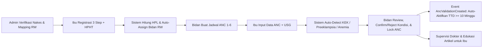

# Product Requirements Document (PRD) — BumilSehat

---

## 1. Document Information

| Atribut | Nilai |
| --- | --- |
| **Product Name** | BumilSehat |
| **Document Version** | 2.0 (Brownfield Blueprint Baseline) |
| **Status** | Approved Baseline (Wave 1 Implemented, Wave 2 Stabilization Planned) |
| **Last Updated** | 2026-11-24 |
| **Target Deployment Scope** | Single-Puskesmas (1 instance aplikasi = 1 Puskesmas) |
| **Related Blueprints** | [ERD.md](./ERD.md) · [TECH_SPEC.md](./TECH_SPEC.md) · [DESIGN.md](./DESIGN.md) · [TASKS.md](./TASKS.md) · [ADR](./adr/README.md) |

### Changelog Rekonsiliasi (v1 → v2.0)
- Menstandarisasi struktur PRD menjadi 19 seksi sesuai alur blueprint lintas-AI.
- Mengoreksi aturan deteksi **Anemia** dari `TD sistolik < 110` (hipotensi) menjadi **`Hb < 11.0 g/dL`** sesuai standar klinis dan implementasi aktual di `AncRecord.php`.
- Mendokumentasikan penuh fitur keamanan NIK sesuai **UU PDP** (*dual-storage* AES + HMAC-SHA256, *role-based masking*, audit log *immutable*), status jadwal ANC **`missed`**, direktori konsultasi WhatsApp berbasis Blade SSR, serta pengelolaan profil & ganti password.
- Memisahkan secara jujur antara fitur **Wave 1 (MVP Eksisting)**, **Wave 2 (Stabilisasi, Security Hardening, & Automated Testing)**, serta item yang belum dibangun (catatan rekomendasi dokter dan penutupan otomatis status kehamilan `completed`).

---

## 2. Executive Summary

**BumilSehat** adalah aplikasi web pemantauan kehamilan berbasis **Puskesmas** di Indonesia yang mendigitalisasi pencatatan **Antenatal Care (ANC)** dari buku KIA konvensional menjadi alur kerja digital yang terstruktur, aman, dan sesuai praktik klinis lapangan.

Prinsip utama operasional BumilSehat:
1. **Ibu Hamil (`mother`)** menginput data ANC secara mandiri saat kunjungan (didampingi Bidan), memantau konsumsi harian Tablet Tambah Darah (TTD), mengakses kontak konsultasi tenaga kesehatan, serta membaca artikel edukasi sesuai usia kandungan.
2. **Bidan (`midwife`)** menjadi penanggung jawab operasional wilayah binaan (Kelurahan/RW): menentukan jadwal ANC ke-1 s.d. ke-6, menandai kunjungan terlewat (*missed*), memvalidasi temuan kondisi risiko, dan mengunci (*lock*) data secara permanen.
3. **Dokter / Nutrisionis / Psikolog (`doctor`)** melakukan supervisi klinis seluruh ibu hamil aktif di Puskesmas secara *read-only* dengan prioritas pemantauan kasus berisiko.
4. **Admin (`admin`)** mengelola verifikasi akun tenaga medis, master data wilayah & spesialisasi, penugasan wilayah bidan, CMS artikel edukasi, dan pemantauan audit log akses NIK melalui Filament Admin Panel.
5. **Sistem** berperan sebagai *decision support* melalui deteksi kondisi risiko otomatis (**KEK**, **Preeklampsia**, **Anemia**) — **bukan diagnosis medis**. Keputusan klinis tetap berada di tangan tenaga kesehatan.

---

## 3. Background & Problem Statement

### Latar Belakang
Pencatatan layanan Antenatal Care (ANC) di banyak Puskesmas masih bergantung pada buku KIA fisik dan rekap manual. Hal ini menimbulkan beberapa kendala di lapangan:
- Riwayat pemeriksaan ANC tersebar, sulit ditelusuri secara cepat saat ibu hamil berkunjung ulang atau saat dokter melakukan supervisi.
- Identifikasi dini faktor risiko kehamilan (KEK, Preeklampsia, Anemia) sering terlambat tersampaikan lintas peran antara Bidan dan Dokter.
- Kepatuhan konsumsi **Tablet Tambah Darah (TTD)** (target 90 tablet selama kehamilan) sulit dipantau harian.
- Data identitas sensitif pasien (khususnya **NIK**) membutuhkan tata kelola keamanan dan audit akses sesuai **UU No. 27 Tahun 2022 tentang Perlindungan Data Pribadi (UU PDP)**.

### Rumusan Masalah
Puskesmas membutuhkan sistem web ringan dan *mobile-first* yang dapat dipakai langsung oleh Ibu Hamil dan tenaga kesehatan untuk menjadwalkan 6 kunjungan ANC, memvalidasi dan mengunci catatan pemeriksaan, memantau TTD, menyampaikan edukasi relevan per minggu kehamilan, serta melindungi data NIK dengan enkripsi dan jejak audit yang tidak dapat dimanipulasi.

---

## 4. Product Vision

Menjadi pendamping digital pencatatan kehamilan tingkat Puskesmas yang **tepat guna, aman secara privasi (UU PDP-compliant), ramah bagi ibu hamil, dan akurat bagi bidan serta dokter** sehingga risiko kehamilan dapat terdeteksi lebih awal dan kepatuhan ANC serta TTD meningkat secara terukur.

---

## 5. Goals & Objectives

1. **Digitalisasi ANC 1–6**: Menyediakan alur terstruktur dari penjadwalan oleh Bidan, pengisian data oleh Ibu, hingga validasi & penguncian permanen oleh Bidan.
2. **Deteksi Dini Faktor Risiko**: Secara otomatis menandai indikator KEK, Preeklampsia, dan Anemia berdasarkan parameter klinis terukur untuk divalidasi Bidan.
3. **Kepatuhan Suplementasi TTD**: Mengaktifkan pemantauan TTD otomatis pada usia kehamilan ≥ 10 minggu saat ANC divalidasi (atau aktivasi manual oleh Bidan) dengan target 90 hari konsumsi.
4. **Perlindungan Data Pribadi (NIK)**: Menjamin NIK tidak pernah tersimpan plaintext di database maupun session, ditampilkan dengan *data minimization* (*masking* per role), dan setiap akses tercatat secara *immutable*.
5. **Edukasi Terarah & Terpercaya**: Menyediakan artikel kesehatan kehamilan yang dikurasi terpusat oleh Admin dan otomatis disaring sesuai usia kehamilan Ibu.
6. **Stabilitas & Kesiapan Produksi (Wave 2)**: Menyelesaikan seluruh temuan bug fungsional, isu keamanan hasil audit (`SEC-002`–`SEC-016`), dan membangun cakupan automated test yang solid.

---

## 6. Target Users

| Segmen Pengguna | Role Sistem | Lingkungan Penggunaan Utama |
| --- | --- | --- |
| **Ibu Hamil** | `mother` | Smartphone (*mobile-first web*) saat di rumah & saat kunjungan ANC di Puskesmas |
| **Bidan Wilayah** | `midwife` | Smartphone / Tablet (*mobile-first web*) saat mendampingi kunjungan & memantau binaan RW |
| **Dokter Umum / Nutrisionis / Psikolog** | `doctor` | Smartphone / Desktop (*mobile-first web*) untuk supervisi kasus berisiko di Puskesmas |
| **Admin Puskesmas** | `admin` | Desktop Web (Filament 5 Admin Panel di `/admin`) |

---

## 7. User Personas

### Persona 1 — Bunda Ani (Ibu Hamil, 27 tahun)
- **Kebutuhan**: Ingin tahu usia kandungan, HPL, jadwal kontrol ANC berikutnya, pengingat catat minum TTD harian, serta kontak cepat ke Bidan pendamping.
- **Kendala**: Tidak terbiasa dengan aplikasi rumit; cemas jika melihat istilah medis menakutkan sebelum dijelaskan Bidan.
- **Solusi Produk**: UI hangat bernuansa *rose*, navigasi 4 tab sederhana, pesan alert kondisi yang tenang & empatik, serta tombol cepat WhatsApp ke Bidan.

### Persona 2 — Bidan Sari (Bidan Wilayah RW 01–02, 34 tahun)
- **Kebutuhan**: Memantau seluruh ibu hamil di RW binaannya, mengatur jadwal ANC 1–6 tanpa duplikasi, segera tahu siapa yang punya risiko atau belum divalidasi, dan mengunci data pemeriksaan yang sah.
- **Kendala**: Jadwal lapangan padat; rawan data pemeriksaan berubah setelah divalidasi jika tidak dikunci.
- **Solusi Produk**: Dashboard prioritas risiko & antrean validasi, *pessimistic locking* saat validasi, penandaan kunjungan terlewat (*missed*), dan *toggle* TTD satu klik.

### Persona 3 — dr. Ahmad (Dokter Puskesmas, 39 tahun)
- **Kebutuhan**: Gambaran menyeluruh kondisi seluruh ibu hamil aktif di Puskesmas, fokus cepat pada pasien dengan KEK/Preeklampsia/Anemia, serta melihat tren riwayat ANC 1–6 beserta foto USG.
- **Kendala**: Waktu terbatas untuk memeriksa buku KIA satu per satu.
- **Solusi Produk**: Dashboard supervisi bernuansa *blue*, ringkasan distribusi kondisi risiko, pencarian pasien (nama/NIK), dan timeline ANC 1–6 tervalidasi.

### Persona 4 — Admin Puskesmas
- **Kebutuhan**: Memverifikasi pendaftar tenaga medis agar tidak ada akun palsu, memetakan wilayah Kelurahan/RW ke Bidan, menambah profesi spesialisasi baru tanpa ubah kode, mengelola artikel edukasi, dan memonitor log akses NIK.
- **Solusi Produk**: Filament 5 Admin Panel dengan 11 resource lengkap dan tabel *read-only* `NikAuditLogs`.

---

## 8. User Roles & Permissions

### Asumsi Operasional Sistem
1. **Single-Puskesmas**: 1 instance aplikasi melayani 1 Puskesmas. Multi-Puskesmas di luar cakupan MVP & Wave 2.
2. **Verifikasi Wajib Nakes**: Akun `midwife` dan `doctor` dibuat dengan `is_verified = false` dan wajib diverifikasi Admin sebelum dapat mengakses dashboard (diarahkan ke `/waiting-approval`). Akun `mother` langsung aktif (`is_verified = true`).
3. **Pemetaan Wilayah Pra-Registrasi**: Admin memetakan `subdistricts`, `areas` (RW), dan `midwife_areas` sebelum Ibu mendaftar. Jika suatu RW belum memiliki Bidan aktif, `assigned_midwife_id` bernilai `null` (tidak ada fallback otomatis) sampai ditetapkan Admin atau Ibu memperbarui wilayah.
4. **Cakupan Akses Dokter (`SEC-RISK-001` Confirmed)**: Karena model Single-Puskesmas, seluruh tenaga medis ber-role `doctor` yang terverifikasi berwenang melihat seluruh ibu hamil aktif di Puskesmas secara *read-only* dengan NIK ter-mask 4 digit awal.

### Matriks Hak Akses

| Kapabilitas | Ibu Hamil (`mother`) | Bidan (`midwife`) | Dokter (`doctor`) | Admin (`admin`) |
| --- | :---: | :---: | :---: | :---: |
| Login berbasis Nomor HP & Password | ✅ | ✅ | ✅ | ✅ (Web & `/admin`) |
| Registrasi Mandiri | ✅ (3 langkah) | ✅ (Butuh verifikasi) | ✅ (Butuh verifikasi) | ❌ (Seeder / Admin) |
| Lihat Dashboard & Profil Sendiri | ✅ | ✅ (Harus verified) | ✅ (Harus verified) | ✅ (`/admin`) |
| Lihat Daftar Ibu Hamil | ❌ (Hanya diri sendiri) | ✅ (Hanya binaan RW) | ✅ (Seluruh Puskesmas, read-only) | ✅ (Semua via Filament) |
| Buat / Ubah / Tandai Missed Jadwal ANC (1–6) | ❌ (Read-only) | ✅ (Pasien binaannya) | ❌ | ❌ (Read-only via Pregnancy) |
| Input / Edit Data ANC & Upload USG | ✅ (Selama belum locked) | ❌ | ❌ | ❌ (Read-only) |
| Validasi Kondisi Risiko & Kunci Data ANC | ❌ | ✅ (Irreversible lock) | ❌ | ❌ |
| Catat Konsumsi Harian TTD | ✅ (Jika TTD aktif) | ❌ | ❌ | ❌ |
| Aktivasi / Toggle Status TTD | ❌ | ✅ (Auto & Manual) | ❌ | ❌ |
| Baca Artikel Edukasi (Filter Usia Kehamilan) | ✅ | ❌ | ❌ | ✅ (Full CMS CRUD) |
| Direktori Konsultasi WhatsApp Nakes | ✅ | ❌ | ❌ | ✅ (Kelola spesialisasi) |
| Akses Tampilan NIK (Data Minimization) | Mask seluruh digit (`****************`) | 6 digit awal (`320401**********`); boleh dekripsi penuh teraudit | 4 digit awal (`3204************`); tidak boleh dekripsi penuh | Penuh (teraudit di `nik_audit_logs`) |
| Kelola User, Wilayah, Spesialisasi, Audit NIK | ❌ | ❌ | ❌ | ✅ |

---

## 9. Business Processes & Formulas

### 9.1 Alur Utama End-to-End

### 9.2 Rumus Klinis & Aturan Otomasi

1. **Perhitungan HPL (Aturan Naegele)**:
   $$\text{HPL} = \text{HPHT} + 280\text{ hari}$$
2. **Usia Kehamilan (Gestational Week)**:
   $$\text{Gestational Week} = \left\lfloor \frac{\text{Hari ini} - \text{HPHT}}{7} \right\rfloor$$
3. **Klasifikasi Trimester**:
   - Trimester 1: usia kehamilan ≤ 12 minggu
   - Trimester 2: usia kehamilan 13–27 minggu
   - Trimester 3: usia kehamilan ≥ 28 minggu
4. **Indeks Massa Tubuh (BMI)** pada `AncRecord`:
   $$\text{BMI} = \text{round}\left(\frac{\text{weight (kg)}}{(\text{height (cm)} / 100)^2},\ 1\right)$$
5. **Deteksi Kondisi Risiko Otomatis** (dijalankan otomatis saat `AncRecord` dibuat/diperbarui sebelum dikunci; kondisi yang sudah `confirmed`/`rejected` tidak ditimpa):

   | Kode Kondisi | Label | Ambang Batas Klinis | Status Awal |
   | --- | --- | --- | --- |
   | `kek` | Kekurangan Energi Kronik (KEK) | `lila < 23.5` cm | `detected` |
   | `preeclampsia` | Preeklampsia | `systolic >= 140` mmHg **ATAU** `diastolic >= 90` mmHg | `detected` |
   | `anemia` | Anemia | `hb < 11.0` g/dL | `detected` |

6. **Aturan Bukti USG**:
   - Wajib pada kunjungan **ANC ke-1** dan **ANC ke-5** (maksimal 1 gambar per `anc_record`, maksimal 2 MB; penegakan *server-side* dituntaskan di Wave 2 `SEC-012`).
7. **Aktivasi Otomatis TTD**:
   - Saat Bidan memvalidasi dan mengunci ANC, event `AncValidationCreated` memicu `AutoActivateTtdOnValidation`.
   - Jika kehamilan terkait (`ancRecord -> schedule -> pregnancy`) berstatus `active` dan usia kehamilan ≥ 10 minggu, maka `ttd_statuses` otomatis dibuat/diaktifkan (`activated_by = 'system'`).
   - Target kepatuhan TTD: **90 tablet** (1 pencatatan per hari pada `ttd_logs`).
8. **Immutability Data**:
   - `AncRecord` dengan `is_locked = true` tidak dapat diubah maupun dihapus (dilindungi model hook `updating` & `deleting`).
   - `NikAuditLog` bersifat *append-only / immutable* (melarang update, delete, dan drop table di production).

---

## 10. Functional Requirements

### Autentikasi & Registrasi
- **FR-001**: Sistem menyediakan login menggunakan `phone` dan `password` dengan pembatasan percobaan (`throttle:10,1`), regenerasi session ID, dan pengalihan otomatis berdasarkan `role` dan status `is_verified`.
- **FR-002**: Sistem menyediakan registrasi **Ibu Hamil 3 langkah** (Akun → Identitas NIK & Domisili Kelurahan/RW/RT → HPHT) yang memvalidasi format 16 digit NIK + kode provinsi (11–99), mencegah duplikasi NIK via `nik_hash`, menghitung HPL otomatis, dan menugaskan Bidan aktif berdasarkan `area_id`.
- **FR-003**: Sistem menyediakan registrasi **Tenaga Medis** (`midwife`/`doctor` ditentukan otomatis dari `specializations.role_group`) dengan status awal `is_verified = false` dan halaman tunggu `/waiting-approval`.
- **FR-004**: Sistem menegakkan otorisasi rute per role melalui middleware `EnsureRole` dan `FilamentUser::canAccessPanel()` (khusus `admin` untuk `/admin`).

### Modul Ibu Hamil (`mother`)
- **FR-005**: Dashboard Ibu menampilkan sapaan waktu WIB, usia janin (minggu & hitung mundur minggu berikutnya), HPL, trimester, status alert kondisi risiko (bahasa empatik), kartu Bidan pendamping + tautan WhatsApp, jadwal ANC terdekat, dan widget TTD 5 hari.
- **FR-006**: Ibu dapat melihat riwayat dan detail seluruh jadwal ANC 1–6 miliknya.
- **FR-007**: Ibu dapat menginput dan memperbarui data ANC (berat badan, tinggi badan, LILA, sistolik, diastolik, Hb, status TT, letak janin, DJJ, dan foto USG) untuk jadwal miliknya yang belum dikunci (`is_locked = false`) dan berstatus layak (`scheduled`).
- **FR-008**: Ibu dapat mencatat konsumsi TTD harian (`POST /mother/ttd/take`) saat `ttd_statuses.is_active = true`.
- **FR-009**: Ibu dapat melihat direktori konsultasi tenaga kesehatan terverifikasi (`/mother/chat`) dengan tombol WhatsApp dan pesan sapaan dari `specializations.wa_greeting`.
- **FR-010**: Ibu dapat membaca dan mencari daftar artikel edukasi berstatus `published` yang disaring otomatis berdasarkan usia kehamilannya (`min_week`–`max_week`), beserta artikel terkait.
- **FR-011**: Ibu dapat mengubah profil diri (termasuk *auto-reassign* Bidan jika `area_id` berubah) dan mengubah kata sandi.

### Modul Bidan (`midwife`)
- **FR-012**: Dashboard Bidan menampilkan wilayah binaan aktif, total ibu dampingan, jadwal ANC hari ini, jumlah antrean validasi, jumlah kasus berisiko, 3 catatan pending terbaru, 3 preview ibu prioritas risiko, dan ringkasan kondisi (KEK, Preeklampsia, Anemia).
- **FR-013**: Bidan dapat melihat daftar pasien binaannya dengan pencarian nama, filter status (`semua`, `risiko`, `validasi`, `normal`), serta detail lengkap pasien (timeline ANC 1–6, progres ANC, kondisi aktif, progres TTD 90 hari).
- **FR-014**: Bidan dapat membuat jadwal ANC 1–6 (unik per kehamilan), memperbarui tanggal/jam jadwal yang belum diisi, serta menandai jadwal sebagai terlewat (`missed`) baik dari jadwal existing maupun secara langsung (`missed-direct`).
- **FR-015**: Bidan dapat meninjau data ANC + foto USG pasien binaannya, mengonfirmasi (`confirm`) atau menolak (`reject`) tiap kondisi risiko dengan catatan, menambah catatan validasi, dan mengunci data secara permanen dalam transaksi + *pessimistic lock* (`lockForUpdate`).
- **FR-016**: Validasi ANC oleh Bidan men-dispatch event `AncValidationCreated` yang secara otomatis mengaktifkan TTD jika usia kehamilan ≥ 10 minggu; Bidan juga dapat mengaktifkan/menonaktifkan TTD secara manual (`PATCH /midwife/pregnancies/{pregnancy}/toggle-ttd`).
- **FR-017**: Bidan dapat mengubah data diri (nama & email; nomor HP hanya melalui Admin) dan mengganti kata sandi.

### Modul Dokter / Nutrisionis / Psikolog (`doctor`)
- **FR-018**: Dashboard Dokter menampilkan ringkasan supervisi seluruh ibu hamil aktif di Puskesmas (total, berisiko, menunggu validasi, normal), jumlah ANC minggu ini, distribusi kondisi risiko, 5 ibu berisiko, dan 3 ANC terkunci terbaru.
- **FR-019**: Dokter dapat mencari pasien (berdasarkan nama atau pencarian tepat 16 digit NIK via `MotherProfile::byNik()`), menyaring status, dan melihat detail timeline ANC 1–6, catatan validasi Bidan, serta gambar USG secara *read-only*.
- **FR-020**: Dokter dapat mengubah nama/email dan mengganti kata sandi.

### Modul Admin (Filament 5 Panel `/admin`)
- **FR-021**: Admin dapat mengelola pengguna (`Users`) termasuk verifikasi akun tenaga medis (`is_verified`).
- **FR-022**: Admin dapat mengelola master wilayah (`Subdistricts`, `Areas`), penugasan wilayah Bidan (`MidwifeAreas`), dan master profesi tenaga medis (`Specializations`) tanpa migrasi skema baru.
- **FR-023**: Admin dapat mengelola konten artikel edukasi (`Articles`: create, edit, rich text + attachment, thumbnail, rentang minggu, draft/published, delete).
- **FR-024**: Admin dapat memantau data klinis secara *read-only* (`MotherProfiles`, `Pregnancies`, `AncRecords`, `DetectedConditions`) dan mengaudit seluruh akses NIK di `NikAuditLogs` (filter aksi, role, dan flag anomali).

### Keamanan NIK & Audit Log (UU PDP)
- **FR-025**: Seluruh penyimpanan, pencarian, masking, dan dekripsi NIK wajib melewati `NIKService` & trait `HasNIKEncryption`, dan setiap operasi baca/dekripsi/gagal wajib tercatat di `nik_audit_logs`.

---

## 11. Non-Functional Requirements

- **NFR-001 (Privasi & Enkripsi NIK — UU PDP)**: NIK tidak boleh tersimpan plaintext di tabel database, session, log aplikasi, maupun *flashed old input*; menggunakan AES-256-CBC (`Crypt::encryptString`) + HMAC-SHA256 (`NIK_HASH_SALT`).
- **NFR-002 (Otorisasi & Anti-IDOR)**: Setiap endpoint mutasi dan tampilan detail wajib memverifikasi kepemilikan data (ibu hanya akses jadwal miliknya, bidan hanya akses ibu binaannya, admin panel terbatas pada `role === 'admin'`).
- **NFR-003 (Integritas Transaksi & Konkurensi)**: Registrasi multi-tabel, penyimpanan ANC, validasi penguncian ANC, dan aktivasi/toggle TTD harus terlindungi transaksi database (`DB::transaction`) dan penguncian baris (`lockForUpdate`) untuk mencegah *race condition* dan data parsial.
- **NFR-004 (Kebijakan Autentikasi & Sesi)**: Sesi wajib dienkripsi (`SESSION_ENCRYPT=true`) di production, cookie aman melalui HTTPS, session ID diregenerasi setelah login & registrasi, dan kebijakan password seragam (minimal 8 karakter di seluruh role pada Wave 2).
- **NFR-005 (Keamanan Konten & Unggahan)**: Unggahan gambar USG dan thumbnail dibatasi tipe gambar & ukuran (maks 2 MB); konten HTML artikel disanitasi sebelum dirender untuk mencegah Stored XSS.
- **NFR-006 (Performa)**: Menjalankan aplikasi menggunakan **Laravel Octane + FrankenPHP** dengan *eager loading* pada seluruh query dashboard untuk menghindari N+1 query.
- **NFR-007 (Usabilitas Mobile-First)**: Antarmuka Ibu Hamil, Bidan, dan Dokter dioptimalkan untuk layar mobile (`max-w-md`) dengan navigasi bawah (*bottom navigation*) yang responsif dan teks berbahasa Indonesia yang mudah dipahami.
- **NFR-008 (Testabilitas)**: Seluruh alur bisnis kritis, enkripsi NIK, deteksi risiko, otorisasi role, dan skenario keamanan memiliki automated tests PHPUnit yang berjalan cepat di SQLite in-memory.
- **NFR-009 (Auditabilitas)**: Catatan audit NIK (`nik_audit_logs`) bersifat *immutable* dan gagal-aman di production (tidak bisa diubah, dihapus, atau di-drop).
- **NFR-010 (Kesiapan Deployment)**: Aplikasi kompatibel penuh dengan **PostgreSQL** di development/production serta mendukung reverse proxy HTTPS melalui konfigurasi `trustProxies` yang aman.

---

## 12. User Stories

| ID | Role | User Story | Mapping FR |
| --- | --- | --- | --- |
| `US-001` | Ibu Hamil | Sebagai Ibu Hamil, saya ingin mendaftar dengan NIK dan alamat Kelurahan/RW serta memasukkan HPHT agar sistem langsung menghitung HPL dan menetapkan Bidan pendamping saya. | FR-002 |
| `US-002` | Ibu Hamil | Sebagai Ibu Hamil, saya ingin melihat usia kehamilan, HPL, jadwal ANC berikutnya, dan kontak WhatsApp Bidan di satu layar utama. | FR-005, FR-009 |
| `US-003` | Ibu Hamil | Sebagai Ibu Hamil, saya ingin menginput hasil pengukuran kunjungan ANC (beserta foto USG pada ANC 1 & 5) sesuai jadwal agar riwayat KIA saya tersimpan digital. | FR-006, FR-007 |
| `US-004` | Ibu Hamil | Sebagai Ibu Hamil, saya ingin menandai konsumsi TTD setiap hari untuk memantau kemajuan menuju target 90 tablet. | FR-008 |
| `US-005` | Ibu Hamil | Sebagai Ibu Hamil, saya ingin membaca artikel kehamilan yang otomatis sesuai minggu kandungan saya. | FR-010 |
| `US-006` | Ibu Hamil | Sebagai Ibu Hamil, saya ingin memperbarui profil (termasuk pindah RW) dan kata sandi dengan aman. | FR-011 |
| `US-007` | Bidan | Sebagai Bidan, saya ingin melihat daftar ibu hamil binaan saya yang diprioritaskan berdasarkan risiko dan antrean validasi. | FR-012, FR-013 |
| `US-008` | Bidan | Sebagai Bidan, saya ingin membuat, menjadwal ulang, dan menandai terlewat (*missed*) jadwal ANC 1–6 tanpa risiko duplikasi nomor ANC. | FR-014 |
| `US-009` | Bidan | Sebagai Bidan, saya ingin meninjau data ANC, mengonfirmasi atau menolak kondisi risiko yang dideteksi sistem, dan mengunci catatan secara permanen. | FR-015 |
| `US-010` | Bidan | Sebagai Bidan, saya ingin TTD otomatis aktif bagi ibu hamil usia ≥ 10 minggu saat ANC divalidasi, serta bisa mengaktifkan/menonaktifkan TTD secara manual. | FR-016 |
| `US-011` | Dokter | Sebagai Dokter/Nutrisionis, saya ingin memantau ringkasan seluruh ibu hamil aktif di Puskesmas dan segera menemukan pasien dengan kondisi risiko KEK/Preeklampsia/Anemia. | FR-018, FR-019 |
| `US-012` | Dokter | Sebagai Dokter, saya ingin mencari ibu hamil berdasarkan nama atau NIK tepat 16 digit dan membaca timeline ANC 1–6 beserta foto USG. | FR-019 |
| `US-013` | Tenaga Medis | Sebagai Bidan/Dokter baru, saya ingin mendaftar sesuai spesialisasi saya dan melihat status tunggu verifikasi sampai disetujui Admin. | FR-003 |
| `US-014` | Admin | Sebagai Admin, saya ingin memverifikasi akun tenaga medis, memetakan Kelurahan/RW ke Bidan, dan menambah jenis spesialisasi baru tanpa migrasi database. | FR-021, FR-022 |
| `US-015` | Admin | Sebagai Admin, saya ingin membuat, mengedit, dan mempublikasikan artikel edukasi kehamilan dengan filter minggu kehamilan. | FR-023 |
| `US-016` | Admin | Sebagai Admin, saya ingin memantau seluruh jejak akses NIK (`READ`, `DECRYPT`, `FAILED`) untuk memastikan kepatuhan UU PDP. | FR-024, FR-025 |

---

## 13. Acceptance Criteria

- **AC-001 (Registrasi Ibu & NIK)**: *Given* Ibu mengisi 3 langkah registrasi dengan NIK valid 16 digit dan RW yang memiliki Bidan aktif, *When* langkah HPHT dikirim, *Then* User, `MotherProfile` (dengan `nik_encrypted` + `nik_hash` tanpa plaintext di session), dan `Pregnancy` (`hpl_date = hpht + 280 hari`) tersimpan atomik, session ID diregenerasi, dan Ibu langsung masuk `/mother/dashboard`.
- **AC-002 (Verifikasi Tenaga Medis)**: *Given* Bidan/Dokter mendaftar baru (`is_verified = false`), *When* mengakses `/midwife/dashboard` atau `/doctor/dashboard`, *Then* middleware `EnsureRole` mengalihkan ke `/waiting-approval` hingga Admin mengubah `is_verified = true`.
- **AC-003 (Isolasi Admin Panel)**: *Given* user dengan role `mother`, `midwife`, atau `doctor` login, *When* mengakses `/admin`, *Then* akses ditolak (`403`) baik di environment `local` maupun `production`.
- **AC-004 (Penjadwalan ANC Unik)**: *Given* Bidan membuat jadwal ANC ke-N untuk pasien binaannya, *When* ANC ke-N sudah ada, *Then* sistem menolak dengan pesan validasi; jika Bidan mengakses pasien di luar wilayah binaannya, sistem mengembalikan `403`.
- **AC-005 (Input ANC & Deteksi Otomatis)**: *Given* Ibu menginput ANC pada jadwal `scheduled` miliknya dengan `lila = 22.0`, `systolic = 145`, dan `hb = 10.2`, *When* disimpan, *Then* `AncRecord` tersimpan, jadwal menjadi `done`, dan 3 record `DetectedCondition` (`kek`, `preeclampsia`, `anemia`) otomatis dibuat dengan status `detected`.
- **AC-006 (Aturan USG ANC 1 & 5)**: *Given* Ibu mengisi form untuk ANC ke-1 atau ke-5 yang belum memiliki foto USG, *When* dikirim tanpa file `usg_image`, *Then* validasi server menolak permintaan (Wave 2 `SEC-012`).
- **AC-007 (Validasi, Penguncian Permanen & Auto-TTD)**: *Given* Ibu dengan usia kehamilan ≥ 10 minggu telah mengisi ANC, *When* Bidan mengonfirmasi/menolak kondisi dan mengunci ANC, *Then* `is_locked = true`, `AncValidation` tersimpan, pengubahan/penghapusan berikutnya ditolak (`LogicException`/422), dan `ttd_statuses` pada kehamilan terkait otomatis aktif (`activated_by = 'system'`).
- **AC-008 (Pencatatan TTD Harian)**: *Given* TTD aktif untuk kehamilan Ibu, *When* Ibu menekan tombol konsumsi TTD hari ini, *Then* `ttd_logs` untuk tanggal hari ini tersimpan dengan `is_taken = true` dan penghitungan progres meningkat (unik per hari).
- **AC-009 (Audit Log & Masking NIK)**: *Given* pengguna mengakses profil Ibu yang menampilkan NIK, *When* ditampilkan melalui `getMaskedNik()`, *Then* format masking sesuai role (Admin penuh, Bidan 6 digit, Dokter 4 digit, Ibu/lainnya semua `*`) dan 1 baris audit tercatat di `nik_audit_logs`; upaya `update`/`delete` pada `NikAuditLog` melempar `LogicException`.
- **AC-010 (Filter Artikel Usia Kehamilan)**: *Given* Admin mempublikasikan artikel dengan `min_week = 13` dan `max_week = 27`, *When* Ibu usia 20 minggu membuka `/mother/articles`, *Then* artikel tampil; *When* Ibu usia 8 minggu membukanya, *Then* artikel tidak muncul.

---

## 14. MVP Scope

### Wave 1 — Core MVP (Sudah Diimplementasikan)
- Autentikasi login nomor HP, registrasi Ibu 3 langkah, registrasi Tenaga Medis + approval.
- Enkripsi dual-storage NIK (`NIKService`, `HasNIKEncryption`) & tabel audit `nik_audit_logs`.
- Panel Admin Filament 5 (11 Resources).
- Dashboard & fitur lengkap Ibu Hamil (ANC 1–6, USG, TTD, Artikel, Direktori Konsultasi WA, Profil).
- Dashboard & fitur lengkap Bidan (Pasien binaan, Jadwal ANC + Missed, Validasi & Lock, Toggle TTD, Profil).
- Dashboard & fitur supervisi Dokter (Ringkasan Puskesmas, Filter risiko, Pencarian nama/NIK, Detail ANC 1–6 + USG, Profil).
- Integrasi Laravel Octane + FrankenPHP & seeder data demo.

### Wave 2 — Stabilization, Security Hardening & Automated Testing (Aktif Dikerjakan Selanjutnya)
- Perbaikan 4 temuan fungsional kritis (pembersihan `EventServiceProvider` legacy & verifikasi auto-discovery TTD, redirect `midwife.profile.setting`, redirect `admin`, penanganan error duplikat kompatibel PostgreSQL).
- Remediasi seluruh isu audit keamanan (`SEC-002` s.d. `SEC-015`, `SEC-RISK-002`, `SEC-RISK-003`).
- Pembangunan rangkaian Automated Tests PHPUnit (Unit, Feature, dan 9 skenario *Security Test Matrix* `SEC-016`).

---

## 15. Out of Scope (Di Luar Wave 1 & Wave 2)

Item berikut secara sadar dikeluarkan dari cakupan saat ini dan dicatat sebagai kandidat pengembangan masa depan (*Future Ideas*):
- Pemantauan pasca melahirkan, nifas, KB, dan kesehatan bayi.
- Modul input catatan rekomendasi klinis terpisah oleh Dokter (saat ini Dokter berfokus pada supervisi *read-only* dan konsultasi via WhatsApp).
- Alur otomatis / tombol UI penutupan status kehamilan (`active` → `completed`) setelah ANC ke-6 selesai atau persalinan.
- Chat *real-time* di dalam aplikasi (saat ini menggunakan direktori kontak deep-link WhatsApp).
- Push notification / pengingat otomatis via WhatsApp API, SMS, atau email.
- Diagnosis otomatis berbasis AI.
- Kontribusi artikel oleh Bidan atau Dokter (komentar/like juga di luar cakupan).
- Dukungan Multi-Puskesmas / Multi-Tenant.
- Ekspor laporan kohort ibu (PDF/Excel) untuk pelaporan Dinas Kesehatan.

---

## 16. Development Waves

| Wave | Nama | Tujuan Utama | Status |
| --- | --- | --- | --- |
| **Wave 1** | Core MVP | Membangun seluruh fitur inti pencatatan ANC 1–6, TTD, NIK UU PDP, Filament Admin, dan dashboard 3 role | **Mayoritas Selesai** (detail per task di [TASKS.md](./TASKS.md)) |
| **Wave 2** | Stabilization, Security Hardening & Testing | Memperbaiki bug fungsional, menutup seluruh celah audit keamanan (`SEC-002`–`SEC-016`), menyelaraskan PostgreSQL + Octane, dan membangun test suite otomatis | **Pending** (prioritas eksekusi berikutnya) |

---

## 17. Dependencies

- **Runtime & Backend**: PHP ^8.2, Laravel ^12.0, Filament ^5.0, Laravel Octane ^2.20 (FrankenPHP).
- **Database**: PostgreSQL (development & production), SQLite in-memory (PHPUnit testing).
- **Frontend**: Node.js >= 18, Vite ^7.0.7, Tailwind CSS ^4.0.0, `@tailwindcss/typography`, Font Awesome 6 Kit, Google Fonts (`Poppins`), DiceBear Avatar API.
- **Konfigurasi Kritis**: `APP_KEY` dan `NIK_HASH_SALT` (wajib tetap konstan setelah data production masuk).
- **Eksternal**: Deep-link WhatsApp (`https://wa.me/62...`) untuk komunikasi ibu dengan tenaga medis.

---

## 18. Risks & Constraints

| Risiko / Batasan | Dampak | Mitigasi |
| --- | --- | --- |
| Perubahan `NIK_HASH_SALT` atau kehilangan `APP_KEY` | Seluruh pencarian `nik_hash` gagal / ciphertext NIK tidak bisa didekripsi | Simpan kunci di secret manager terpisah + dokumentasi larangan rotasi tanpa migrasi ulang. |
| Race condition antara edit ANC Ibu vs validasi Bidan (`SEC-004`) | Data klinis berubah setelah divalidasi | Transaksi + `lockForUpdate` + guarded update pada Wave 2. |
| Penyimpanan NIK plaintext di session registrasi (`SEC-002`) | Kebocoran PII jika tabel `sessions` bocor | Enkripsi nilai NIK sebelum masuk session + aktifkan `SESSION_ENCRYPT=true` + hapus `withInput()` untuk NIK (Wave 2). |
| Duplikasi atau gagalnya eksekusi listener `AutoActivateTtdOnValidation` | TTD gagal aktif atau tereksekusi ganda saat validasi ANC | Gunakan event auto-discovery Laravel 12 (hapus `EventServiceProvider` legacy), tambah test discovery, dan bungkus konsistensi transaksi (Wave 2). |
| Wilayah RW belum memiliki Bidan aktif | Ibu terdaftar tanpa `assigned_midwife_id` | Admin wajib mapping `midwife_areas` sebelum onboarding; UI menampilkan status informatif. |
| Ketergantungan CDN eksternal (Google Fonts, Font Awesome Kit, DiceBear) | Ikon/avatar/font gagal muat di jaringan Puskesmas tanpa internet stabil | Terima sebagai risiko MVP; pertimbangkan *self-hosting* aset di iterasi mendatang. |

---

## 19. Success Metrics

| Metrik | Target | Cara Pengukuran |
| --- | --- | --- |
| Kelengkapan Validasi ANC | 100% catatan ANC yang divalidasi terkunci permanen tanpa inkonsistensi | Query `anc_records` vs `anc_validations` & automated tests |
| Keakuratan Deteksi Risiko & Auto-TTD | 100% deteksi KEK/Preeklampsia/Anemia dan aktivasi TTD ≥ 10 minggu sesuai aturan klinis | PHPUnit Feature & Unit Tests |
| Kepatuhan Privasi NIK (UU PDP) | 0 NIK plaintext di DB/session/log; 100% akses NIK tercatat di `nik_audit_logs` | Audit log review & security tests (`SEC-002`, `SEC-007`) |
| Remediasi Audit Keamanan Wave 2 | 100% temuan High & Medium (`SEC-002`–`SEC-015`) tertutup dengan regression tests | `composer test` hijau + review checklist `TASKS.md` |
| Kesiapan Cross-AI Governance | 100% sinkronisasi antara `PRD.md`, `ERD.md`, `TECH_SPEC.md`, `DESIGN.md`, `TASKS.md`, `AGENTS.md`, dan kode aktual | Review konsistensi setiap akhir task/wave |
