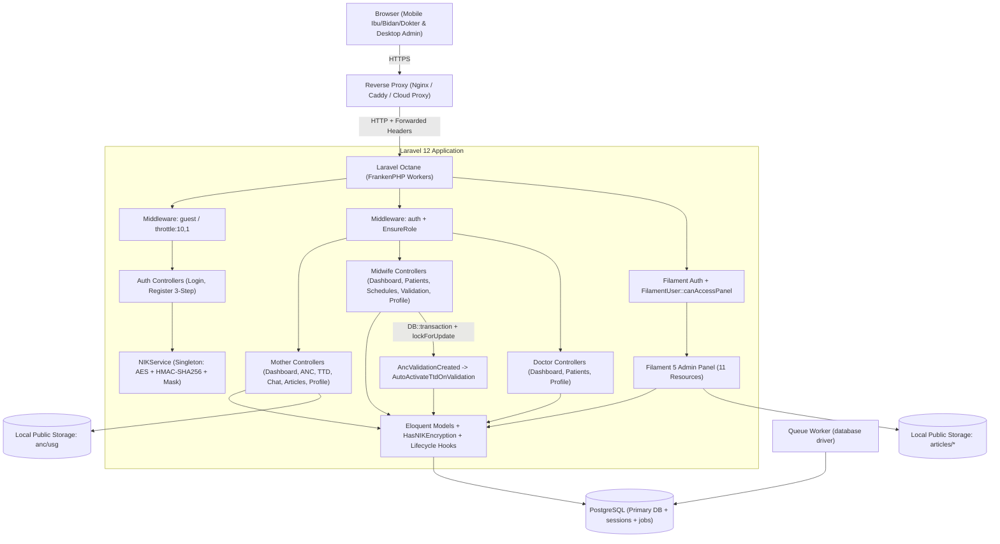

# Technical Specification (TECH_SPEC) — BumilSehat

---

## 1. Technical Overview

**BumilSehat** adalah aplikasi web monolitik berbasis **Laravel 12** (PHP 8.2+) yang menyajikan dua permukaan antarmuka terintegrasi:
1. **Aplikasi Pengguna (Blade SSR + Tailwind CSS v4)**: Antarmuka *mobile-first* yang dipisahkan berdasarkan peran (`mother`, `midwife`, `doctor`) melalui route group dan middleware `EnsureRole`.
2. **Panel Administrasi (Filament 5 / Livewire)**: Antarmuka desktop-first di `/admin` yang dilindungi kontrak `FilamentUser` khusus peran `admin` dengan 11 resource manajemen master data, verifikasi nakes, artikel CMS, dan audit log NIK.

Aplikasi dijalankan di atas **Laravel Octane + FrankenPHP** dengan database utama **PostgreSQL** (dan SQLite in-memory khusus untuk PHPUnit).

---

## 2. Approved Technology Stack

| Layer | Teknologi | Versi Terpasang / Target | Catatan |
| --- | --- | --- | --- |
| **Language** | PHP | `^8.2` | Strict typing pada service & model |
| **Backend Framework** | Laravel Framework | `^12.0` | Routing di `routes/web.php`, bootstrap di `bootstrap/app.php` |
| **App Server / Runtime** | Laravel Octane + FrankenPHP | `^2.20` | Worker mode di belakang reverse proxy HTTPS |
| **Admin Panel** | Filament | `^5.0` | Auto-discovered resources di `app/Filament/Resources` |
| **Primary Database** | PostgreSQL | 15+ / 16+ | Standar development & production ([ADR-0001](./adr/0001-database-selection.md)) |
| **Test Database** | SQLite In-Memory | `:memory:` | Dikonfigurasi di `phpunit.xml` |
| **Frontend Templating** | Blade SSR + Alpine/Livewire (Admin) | Bawaan Laravel 12 | Tanpa SPA framework terpisah |
| **CSS Framework** | Tailwind CSS + Typography Plugin | `^4.0.0` (`@tailwindcss/vite`) | Token di `resources/css/app.css` |
| **Build Tool** | Vite + `laravel-vite-plugin` | `^7.0.7` / `^2.0.0` | Input tunggal: `resources/css/app.css` & `resources/js/app.js` |
| **HTTP Client (JS)** | Axios | `^1.11.0` | Terpasang di `resources/js/bootstrap.js` |
| **Code Formatting** | Laravel Pint | `^1.24` | `vendor/bin/pint` |
| **Testing** | PHPUnit | `^11.5.50` | `composer test` / `php artisan test` |

> **Aturan Integritas Stack**: Perubahan mayor framework, penggantian DBMS, atau penambahan package baru harus disetujui pengguna dan didokumentasikan melalui pembaruan `TECH_SPEC.md` serta ADR baru.

---

## 3. System Architecture



---

## 4. Application Structure

```text
bumil-sehat/
├── app/
│   ├── Events/               # AncValidationCreated
│   ├── Exceptions/           # InvalidNIKException
│   ├── Filament/Resources/   # 11 Filament 5 Resources (Schemas, Tables, Pages)
│   ├── Http/
│   │   ├── Controllers/
│   │   │   ├── Auth/         # LoginController, RegisterController
│   │   │   ├── Mother/       # Dashboard, Anc, Ttd, Chat, Article, Profile
│   │   │   ├── Midwife/      # Dashboard, Patient, Schedule, Validation, Profile
│   │   │   └── Doctor/       # Dashboard, Patient, Profile
│   │   ├── Middleware/       # EnsureRole, RedirectIfAuthenticated
│   │   └── Requests/         # StoreAncValidationRequest (+ FormRequest tambahan Wave 2)
│   ├── Listeners/            # AutoActivateTtdOnValidation
│   ├── Models/               # 17 Eloquent domain models
│   ├── Providers/            # AppServiceProvider, Filament/AdminPanelProvider
│   ├── Services/             # NIKService (singleton)
│   └── Traits/               # HasNIKEncryption
├── bootstrap/
│   ├── app.php               # Routing, middleware aliases (role, guest), redirectGuestsTo, trustProxies
│   └── providers.php         # Service provider registry
├── config/                   # Konfigurasi Laravel & Octane (config/octane.php)
├── database/
│   ├── migrations/           # 19 migrasi database
│   └── seeders/              # DatabaseSeeder -> Specialization -> Subdistrict -> MedicalStaff -> Mother
├── docs/                     # Blueprint resmi: PRD, ERD, TECH_SPEC, TASKS, DESIGN, adr/
├── resources/
│   ├── css/app.css           # Tailwind CSS v4 @theme tokens & custom utilities
│   ├── js/app.js             # Entry point JS Vite
│   └── views/
│       ├── auth/             # Login, choose-role, register-mother (3 step), register-medical, waiting-approval
│       ├── dashboard/        # mother/, midwife/, doctor/
│       └── layouts/          # app, mother(+plain), midwife(+plain), doctor(+plain)
├── routes/web.php            # Seluruh web route terkelompok per role
└── tests/                    # PHPUnit Unit & Feature tests
```

---

## 5. Backend Architecture

1. **Role-Scoped Controllers**: Controller dipisahkan berdasarkan peran (`Auth`, `Mother`, `Midwife`, `Doctor`) untuk menjaga batas otorisasi jelas dan mencegah kebocoran logika antar peran.
2. **Service Layer Terfokus**:
   - `App\Services\NIKService` didaftarkan sebagai singleton di `AppServiceProvider` untuk enkripsi (`Crypt::encryptString`), dekripsi (`Crypt::decryptString`), HMAC-SHA256 (`hashNIK`), validasi format/provinsi, dan *masking* berdasarkan role.
   - Tidak membuat lapisan repository/service spekulatif di luar kebutuhan nyata; transaksi bisnis multi-step ditempatkan di FormRequest/controller atau service terfokus bila kompleksitasnya menuntut.
3. **Domain Lifecycle Hooks pada Eloquent Models**:
   - `AncRecord::booted()`:
     - `created`: menjalankan `detectConditions()` dan `schedule->markAsDone()`.
     - `updated`: mereset ulang kondisi `detected` (tanpa menyentuh `confirmed`/`rejected`) kecuali perubahan hanya pada `is_locked`.
     - `updating` & `deleting`: melempar `LogicException` jika `is_locked = true`.
   - `NikAuditLog::booted()`: melempar `LogicException` pada `updating` dan `deleting` (immutable).
4. **Domain Event & Listener Flow**:
   - `Midwife\ValidationController@validate` mengunci record ANC dalam `DB::transaction` dengan `lockForUpdate()`, lalu men-dispatch `AncValidationCreated`.
   - `AutoActivateTtdOnValidation` mengaktifkan TTD jika usia kehamilan ≥ 10 minggu.
   - **Auto-Discovery & Perbaikan Wave 2**: Laravel 12 otomatis mendaftarkan listener di `app/Listeners` (`AncValidationCreated` → `AutoActivateTtdOnValidation`, diverifikasi oleh `AncValidationEventDiscoveryTest` tanpa `EventServiceProvider` legacy agar tidak tereksekusi ganda). Pada Wave 2 berikutnya (`W2-010`), lookup kehamilan diarahkan ke `$ancRecord->schedule->pregnancy` (`SEC-006`) dan eksekusi disatukan dalam batas transaksi validasi (`SEC-010`, [ADR-0004](./adr/0004-runtime-octane-and-atomic-ttd-activation.md)).
5. **Octane State Safety**:
   - `NIKService` hanya menyimpan `$salt` (*readonly string* dari konfigurasi) sehingga aman dijadikan singleton di worker Octane.
   - Hindari menyimpan state per-request pada properti statis atau singleton mana pun.

---

## 6. Frontend Architecture

1. **Server-Side Rendering (Blade)**: Seluruh halaman publik dan dashboard role (`mother`, `midwife`, `doctor`) dirender di server menggunakan Blade dengan sedikit vanilla JS untuk interaksi ringan (toggle password, modal, konfirmasi fetch `PATCH toggle-ttd`).
2. **Tailwind CSS v4 via Vite**:
   - Sumber pemindaian kelas didefinisikan eksplisit melalui direktif `@source` di `resources/css/app.css`.
   - Plugin `@tailwindcss/typography` digunakan untuk merender konten HTML artikel edukasi.
3. **Layout Berbasis Peran**:
   - `layouts.mother` & `layouts.mother-plain` (tema *rose*, bottom nav 4 tab).
   - `layouts.midwife` & `layouts.midwife-plain` (tema *rose*, bottom nav 4 tab).
   - `layouts.doctor` & `layouts.doctor-plain` (tema *blue*, bottom nav 3 tab).
   - `layouts.app` untuk halaman autentikasi & onboarding.
4. **Filament 5 Admin Panel**: Menggunakan stack Livewire/Alpine bawaan Filament dengan warna primer `Color::Rose` dan auto-discovery di `AdminPanelProvider`.

---

## 7. Routing & Internal HTTP Contracts

Seluruh rute browser didefinisikan terpusat di `routes/web.php` (total 96 route termasuk Filament & Livewire):

| Group / Prefix | Middleware | Endpoint Utama |
| --- | --- | --- |
| Guest (`/`, `/login`, `/register/*`) | `guest` (+ `throttle:10,1` pada `POST /login`) | Login, pilih role, registrasi Ibu 3 step (`mother`, `identity`, `hpht`), registrasi medis |
| Authenticated Umum | `auth` | `POST /logout`, `GET /waiting-approval` |
| Mother (`/mother/*`) | `auth`, `role:mother` | `dashboard`, `anc/history`, `anc/{schedule}`, `anc/{schedule}/form` (GET/POST), `ttd/take` (POST), `chat`, `articles`, `articles/{article:slug}`, `setting`, `profile/edit`, `profile/password` |
| Midwife (`/midwife/*`) | `auth`, `role:midwife` | `dashboard`, `patients`, `patients/{motherProfile}`, `schedules` (GET/POST/create), `schedules/{schedule}` (PUT), `schedules/{schedule}/missed` (PATCH), `schedules/missed-direct/{motherProfile}` (POST), `anc/{ancRecord}/validate` (GET/POST), `pregnancies/{pregnancy}/toggle-ttd` (PATCH JSON), `profile/{setting,edit,password}` |
| Doctor (`/doctor/*`) | `auth`, `role:doctor` | `dashboard`, `patients`, `patients/{motherProfile}`, `setting`, `profile/{edit,password}` |
| Admin (`/admin/*`) | Filament `Authenticate` + `FilamentUser` | Dashboard + 11 CRUD/View Resources |
| Health Check | Public | `GET /up` |

### Kontrak JSON Internal
- `PATCH /midwife/pregnancies/{pregnancy}/toggle-ttd` → mengembalikan `{ "success": true, "is_active": bool }` (dipanggil via `fetch` dengan CSRF token dari `patient-detail.blade.php`).
- `POST /midwife/schedules/missed-direct/{motherProfile}` → mengembalikan redirect *back* dengan flash session (atau `422` JSON jika nomor ANC sudah ada).

---

## 8. Authentication & Authorization

1. **Authentication**:
   - Berbasis Laravel Web Session Guard dengan kredensial `phone` + `password`.
   - Login dilindungi `throttle:10,1` dan regenerasi session ID (`$request->session()->regenerate()`).
   - **Wave 2 (`SEC-003`)**: Menambahkan regenerasi session ID pada registrasi Ibu dan Tenaga Medis setelah `Auth::login($user)`.
2. **Role Authorization (`EnsureRole`)**:
   - Memeriksa kesesuaian `$user->role` terhadap parameter middleware `role:...`; bila tidak cocok, mengalihkan ke dashboard role milik user.
   - Jika role adalah `midwife` atau `doctor` dan `! $user->is_verified`, mengalihkan ke `/waiting-approval`. Peran `mother` tidak memerlukan verifikasi manual.
3. **Filament Admin Isolation**:
   - `App\Models\User` mengimplementasikan `Filament\Models\Contracts\FilamentUser` dengan `canAccessPanel(Panel $panel): bool` yang hanya mengizinkan `$this->role === 'admin'`.
4. **Resource Ownership (Anti-IDOR)**:
   - Mother: wajib memverifikasi `$schedule->pregnancy?->mother_id === $motherProfile->id` (abort `403`).
   - Midwife: wajib memverifikasi `assigned_midwife_id === $user->id` (abort `403` / `firstOrFail`) pada pasien, jadwal, validasi ANC, dan toggle TTD.
   - Doctor: akses baca seluruh ibu dengan kehamilan aktif dalam satu Puskesmas (`abort_if(! $motherProfile->activePregnancy, 404)`).

---

## 9. Database Strategy

1. **Engine**: PostgreSQL untuk development & production; SQLite in-memory untuk PHPUnit ([ADR-0001](./adr/0001-database-selection.md)).
2. **Transaksi & Locking**:
   - Validasi ANC menggunakan `DB::transaction` + `AncRecord::lockForUpdate()->findOrFail(...)`.
   - **Wave 2**:
     - Bungkus penulisan registrasi Ibu (`User` + `MotherProfile` + `Pregnancy`) dalam `DB::transaction` (`SEC-009`) dan tangani duplikasi menggunakan `Illuminate\Database\UniqueConstraintViolationException` (menggantikan kode error MySQL `1062`).
     - Bungkus penulisan ANC Ibu (`Mother\AncController@store`) dalam `DB::transaction` + lock baris jadwal/record untuk mencegah *race condition* terhadap validasi Bidan (`SEC-004`).
     - Gunakan lock baris `Pregnancy` dalam transaksi pada pembuatan/toggle `TtdStatus` (`SEC-011`).
3. **N+1 Query Prevention**: Seluruh controller dashboard (`Mother`, `Midwife`, `Doctor`) menggunakan *eager loading* (`with(...)`) dan agregasi koleksi / query `GROUP BY` tunggal.
4. **Seeding Order**: `DatabaseSeeder` menjalankan urutan deterministik: Admin User → `SpecializationSeeder` → `SubdistrictSeeder` → `MedicalStaffSeeder` → `MotherSeeder`.

---

## 10. Validation Strategy

- Gunakan Form Request class (seperti `StoreAncValidationRequest`) untuk validasi kompleks + otorisasi dan pesan error berbahasa Indonesia.
- Validasi NIK menggunakan aturan `digits:16` plus validasi domain `NIKService` (kode provinsi `11–99` dan `InvalidNIKException`).
- **Penguatan Wave 2**:
  - Validasi relasi `areas.subdistrict_id === subdistrict_id` pada registrasi dan edit profil Ibu (`SEC-008`).
  - Validasi kondisional server-side `usg_image` wajib pada ANC ke-1 dan ke-5 jika belum ada foto USG sebelumnya (`SEC-012`).
  - Validasi status kelayakan jadwal (`status === 'scheduled'` dan milik `activePregnancy`) sebelum menyimpan ANC (`SEC-005`).
  - Penyetaraan kebijakan password minimum 8 karakter terpusat untuk semua role (`SEC-014`).

---

## 11. Error Handling

- Gunakan `abort(403)` / `abort(404)` / `abort(422)` untuk penolakan otorisasi, entitas tidak ditemukan, dan pelanggaran aturan bisnis.
- Exception domain:
  - `InvalidNIKException`: format NIK / kode wilayah tidak valid.
  - `LogicException`: pelanggaran *immutability* pada `AncRecord` terkunci dan `NikAuditLog`.
  - `DecryptException` (`NIKService::decrypt`): dibungkus pesan aman tanpa pernah membocorkan ciphertext atau plaintext NIK.
  - `UniqueConstraintViolationException`: menangani konflik duplikasi unik lintas-DBMS secara deterministik.
- Production wajib `APP_DEBUG=false` agar stack trace dan variabel lingkungan tidak pernah tampil ke pengguna.

---

## 12. Logging & Monitoring

- **Application Logs**: `LOG_CHANNEL=stack` (`single`/`daily`), level `debug` di lokal dan `warning`/`error` di production. Dilarang mencatat NIK, password, atau session token ke log.
- **NIK Security Audit Trail**: Seluruh akses baca/dekripsi/kegagalan akses NIK dicatat ke tabel `nik_audit_logs` lengkap dengan `actor_id`, `actor_role`, `ip_address`, `user_agent`, `metadata`, dan penanda `is_anomaly = true` untuk percobaan ilegal (`FAILED`).
- **Health Check Endpoint**: `GET /up` disediakan untuk *liveness probe* load balancer / container orchestrator.
- **Local Log Inspection**: `php artisan pail` tersedia dalam script `composer run dev`.

---

## 13. Queue & Background Processing

- **Driver**: `QUEUE_CONNECTION=database` di production (tabel `jobs`, `job_batches`, `failed_jobs`) dengan worker terkelola (`php artisan queue:work`) untuk task asinkron di masa depan, serta `sync` pada PHPUnit (`phpunit.xml`).
- **Strategi Aktivasi TTD**: Listener `AutoActivateTtdOnValidation` tetap dieksekusi **sinkron dan atomik** bersama alur validasi ANC ([ADR-0004](./adr/0004-runtime-octane-and-atomic-ttd-activation.md)) agar tidak terjadi ketidakkonsistenan data antara ANC terkunci dan status TTD bila worker queue sedang tertunda (`SEC-010`).

---

## 14. File Storage

- **Disk Utama Unggahan**: `public` (`storage/app/public`, diakses via symlink `public/storage` menggunakan `php artisan storage:link`).
- **Struktur Direktori**:
  - `anc/usg/` — Foto hasil USG kehamilan (validasi `image`, maks `2048` KB).
  - `articles/thumbnails/` — Gambar thumbnail artikel edukasi (Filament `FileUpload`).
  - `articles/images/` — Lampiran gambar di dalam konten artikel (Filament `RichEditor`).
- **Catatan Privasi**: Pada iterasi keamanan lanjutan, penyimpanan `anc/usg/` dapat dipindahkan ke disk `local` (*private*) dengan route signed/terotorisasi agar foto USG tidak dapat diakses lewat URL publik langsung.

---

## 15. Security Architecture

Ringkasan kontrol keamanan aktif dan target Wave 2:

| Domain | Kontrol Eksisting | Penguatan Wave 2 |
| --- | --- | --- |
| **NIK (UU PDP)** | AES-256-CBC + HMAC-SHA256, `$hidden`, `HasNIKEncryption`, `NikAuditLog` immutable | Hapus NIK plaintext dari session & `withInput()` (`SEC-002`); wajibkan semua view/Filament pakai `getMaskedNik()` (`SEC-007`) |
| **Auth & Session** | Phone login, `throttle:10,1`, session regenerate di login, `EnsureRole`, `FilamentUser` | Regenerasi session saat registrasi (`SEC-003`); `SESSION_ENCRYPT=true` & secure cookies (`SEC-013`); password min 8 karakter seragam (`SEC-014`) |
| **Concurrency & Integrity** | `lockForUpdate` di validasi Bidan, `LogicException` pada record terkunci | Transaksi + lock di simpan ANC Ibu (`SEC-004`), filter jadwal eligible (`SEC-005`), validasi relasi area-kelurahan (`SEC-008`), transaksi registrasi (`SEC-009`), atomic TTD (`SEC-006`, `SEC-010`, `SEC-011`), integritas `mother_id` (`SEC-015`) |
| **Content & Supply Chain** | Escaped Blade `{{ }}` di seluruh form & teks biasa | Sanitasi HTML allowlist untuk konten rich text artikel (`SEC-RISK-002`); `composer audit` & `npm audit` (`SEC-RISK-003`) |

---

## 16. Testing Strategy

- **Runner**: `composer test` (menjalankan `php artisan config:clear` lalu `php artisan test`) atau `php artisan test --filter=...`.
- **Environment Test (`phpunit.xml`)**: SQLite `:memory:`, array cache/session/mail, `QUEUE_CONNECTION=sync`, `BCRYPT_ROUNDS=4`. Test yang memakai `NIKService` wajib menyediakan `NIK_HASH_SALT` non-empty di environment/test setup.
- **Target Cakupan Wave 2**:
  1. **Unit Tests**: `NIKService` (encrypt/decrypt, HMAC determinism, format/region validation, masking per role), kalkulasi `Pregnancy` (gestational week, trimester, HPL), deteksi kondisi & BMI `AncRecord`, immutability `NikAuditLog`.
  2. **Feature Tests (Role & Alur Bisnis)**: Login/logout + redirect semua role (termasuk admin `/admin` & `waiting-approval`), registrasi Ibu 3 step & tenaga medis, penjadwalan/missed ANC, input ANC + USG, validasi & penguncian ANC + auto-aktivasi TTD, pencatatan TTD harian, filter artikel per minggu, update profil & password seluruh role.
  3. **Security Test Matrix (`SEC-016`)**: Seluruh 9 skenario wajib (isolasi `/admin`, matriks role, keamanan NIK di session/audit, IDOR lintas role, rollback & duplikasi registrasi, penolakan jadwal non-eligible & USG wajib ANC 1/5, konkurensi simpan vs validasi, target kehamilan TTD, dan sanitasi XSS artikel).

---

## 17. Deployment Architecture

- **Runtime Produksi**: `php artisan octane:start --server=frankenphp` di belakang reverse proxy dengan TLS/HTTPS aktif (wajib untuk data kesehatan sensitif).
- **Proxy Handling**: Konfigurasi `$middleware->trustProxies(...)` di `bootstrap/app.php` dibatasi pada IP/CIDR proxy tepercaya (atau dikontrol via env) dan `OCTANE_HTTPS=true` saat TLS diterminasi di reverse proxy.
- **Checklist Rilis Produksi**:
  1. `APP_ENV=production`, `APP_DEBUG=false`, `SESSION_ENCRYPT=true`, `SESSION_SECURE_COOKIE=true`, `OCTANE_HTTPS=true`.
  2. `APP_KEY` dan `NIK_HASH_SALT` tersimpan aman dan tidak pernah diubah setelah data produksi ada.
  3. `php artisan migrate --force`, `php artisan storage:link`, `npm run build`.
  4. `php artisan optimize` (config, route, view cache) dan restart worker Octane (`php artisan octane:reload`) serta queue worker (`php artisan queue:restart`).
  5. Pastikan akun demo seeder dihapus/diganti kredensialnya.

---

## 18. Environment Configuration

| Variable | Wajib | Default Dev | Nilai Produksi Disarankan | Keterangan |
| --- | :-: | --- | --- | --- |
| `APP_ENV` | ✅ | `local` | `production` | Memengaruhi proteksi drop `nik_audit_logs` & keamanan Filament |
| `APP_DEBUG` | ✅ | `true` | `false` | Wajib `false` di production |
| `APP_KEY` | ✅ | Generated | Rahasia permanen | Kunci AES untuk `Crypt` & `nik_encrypted` |
| `NIK_HASH_SALT` | ✅ | 64-char hex | Rahasia permanen | Salt HMAC-SHA256 untuk `nik_hash` (JANGAN diubah setelah ada data) |
| `APP_URL` | ✅ | `http://127.0.0.1:8000` | `https://<domain>` | Base URL aplikasi & asset storage |
| `DB_CONNECTION` | ✅ | `pgsql` | `pgsql` | PostgreSQL ([ADR-0001](./adr/0001-database-selection.md)) |
| `DB_HOST` / `DB_PORT` | ✅ | `127.0.0.1` / `5432` | Host PostgreSQL | Koneksi database |
| `DB_DATABASE` / `USERNAME` / `PASSWORD` | ✅ | `bumil_sehat` | Kredensial prod | Kredensial PostgreSQL |
| `OCTANE_SERVER` | ✅ | `frankenphp` | `frankenphp` | Driver Octane |
| `OCTANE_HTTPS` | Opsional | `false` | `true` | Paksa skema HTTPS di balik reverse proxy |
| `SESSION_DRIVER` | ✅ | `database` | `database` | Penyimpanan sesi |
| `SESSION_ENCRYPT` | ✅ | `true` | `true` | Enkripsi payload sesi (`SEC-002`, `SEC-013`) |
| `SESSION_SECURE_COOKIE` | Opsional | `false` | `true` | Cookie hanya dikirim via HTTPS |
| `QUEUE_CONNECTION` | ✅ | `database` | `database` | Queue background worker |
| `FILESYSTEM_DISK` | ✅ | `local` | `local` (unggah USG/artikel eksplisit ke `public`) | Konfigurasi disk default |

---

## 19. Technical Constraints

1. **Single-Puskesmas Scope**: Tidak ada kolom `puskesmas_id` / *tenant isolation*; seluruh tabel diasumsikan milik 1 fasilitas Puskesmas.
2. **Permanensi Kunci Kriptografi**: Mengubah `APP_KEY` tanpa `APP_PREVIOUS_KEYS` merusak dekripsi `nik_encrypted`; mengubah `NIK_HASH_SALT` memutus seluruh pencarian `MotherProfile::byNik()` dan pengecekan duplikasi NIK.
3. **Ketergantungan Layanan Eksternal Ringan**: Font `Poppins`, ikon Font Awesome Kit, dan avatar DiceBear dimuat dari CDN; komunikasi konsultasi bergantung pada deep-link WhatsApp di perangkat pengguna.
4. **Laravel Octane Long-Lived Process**: Kode baru tidak boleh menyimpan mutable request state pada static properties, global variables, atau singleton container bindings.
5. **Larangan Penghapusan Audit Log**: `nik_audit_logs` tidak boleh di-truncate atau di-drop pada environment `production`.
